# Buck 降压电源学习笔记：从开关脉冲到 PCB 布局

> **导语**：本文把「第三次硬件培训记录」（Buck 基础 + SCT2450 芯片 + PCB 布局实操）与「第五次培训」（原理推导 + 逐引脚设计 + H 桥 / Boost 辨析）合并重排，按「原理 → 拓扑 → 芯片 → 计算 → 实操 → 拓展」的知识递进组织。原文配图与截图的信息已整理为文字描述、表格与公式，并按本文需要重新配图；两份材料中互相冲突的说法（二极管续流与 MOS 管续流、3.3V 典型应用与 5V 自设计、C16 与 CBOOT、六步走与十步布局）已在正文中统一。
>
> **配图说明**：本文共配 39 张图，全部放在同目录的 `buck-notes-images/` 文件夹，随文标注来源。fig01～fig18 是第三次培训记录的原始截图，fig19～fig23 是第五次培训的手写与对比图，fig24～fig39 是第五次培训引用的外部资料示意图（已标注出处）。图片用于辅助理解，正文的文字、表格与公式保持自洽。

* * *

## 目录

1. [Buck 降压：从开关脉冲到稳定低压](#一-buck-降压从开关脉冲到稳定低压)
2. [异步与同步整流：续流元件决定电路名字](#二-异步与同步整流续流元件决定电路名字)
3. [SCT2450：把典型应用电路逐引脚拆开](#三-sct2450把典型应用电路逐引脚拆开)
4. [电感电流纹波与选型](#四-电感电流纹波与选型)
5. [PCB 布局实操：从原理图到铺铜](#五-pcb-布局实操从原理图到铺铜)
6. [H 桥与 Boost：别把半桥和拓扑混为一谈](#六-h-桥与-boost别把半桥和拓扑混为一谈)
7. [总结与注意事项](#七-总结与注意事项)

* * *

## 一、 Buck 降压：从开关脉冲到稳定低压

### 1.1 先认识电路里都有谁

> **电路描述**：Buck 电路的结构是——输入电压 $V_{in}$ 经上管 MOSFET 接到开关节点；开关节点对地接一只续流二极管；开关节点之后串联电感 $L$ 到输出端；输出端对地并联输出电容 $C$ 与负载 $R_L$；输入侧另有输入电容。原记录的图 1 是一张带手写标注的该结构原理图。

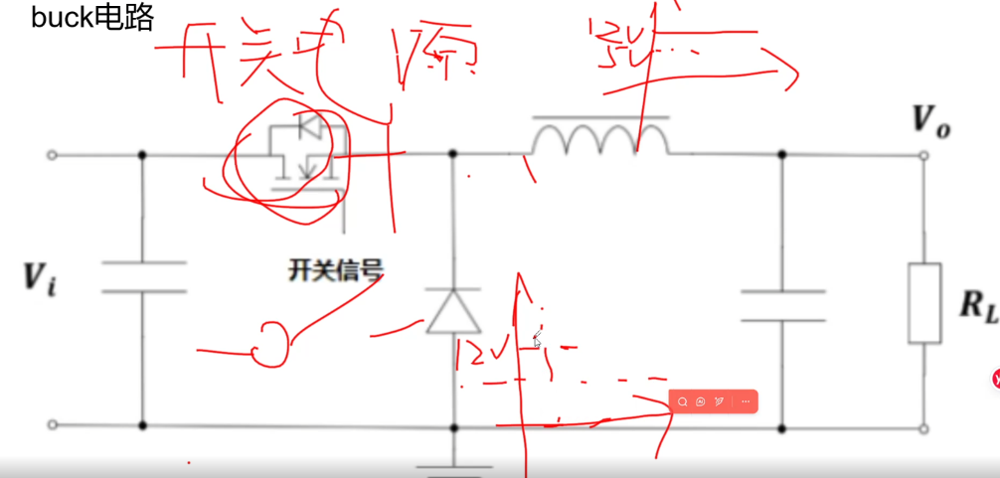

> **图注**：第三次培训记录 图 1：红笔圈出开关管与续流二极管，输入标 12V，右侧 $R_L$ 为负载。

典型 Buck 电路的五个部分：

| 元件 | 位置 / 记号 | 作用 |
| :--- | :--- | :--- |
| MOSFET | 上管，主开关 | 由高低电平控制导通与关断，把输入电压「切」成脉冲 |
| 二极管 | 中间，续流管 | 开关关断时为电感电流提供回路 |
| 电感 $L$ | 输出侧串联 | 储能与释能，阻碍电流突变 |
| 输入 / 输出电容 | 分别对地并联 | 稳定输入端与输出端的电压 |
| 负载 $R_L$ | 输出端 | 消耗电能，$V_o$ 即其两端电压 |

其中 $V_i$ / $V_o$ 分别是输入电压（高压）与输出电压（低压）。真正需要理解透的是 **MOSFET、电感、电容** 这三者的分工。

:::tip[一句话记住分工]
开关管控制时间，电感传递能量，电容平滑电压。
:::

### 1.2 只有两种工作状态

电感的基本规律是：

$$ u_L = L\frac{di_L}{dt} $$

它说明电感两端电压越大，电流变化越快；电感量越大，电流变化越慢。电感不会让电流瞬间变大，也不会允许电流瞬间变成 0。

先用最直观的**异步 Buck（二极管续流）**模型看两个状态：

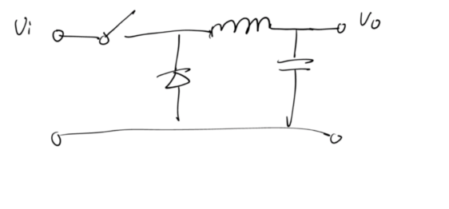

> **图注**：第五次培训手写图：$V_i$ → 开关 → 电感 → $V_o$，二极管与输出电容接地，是最简洁的异步 Buck 骨架。

| | 状态一：MOS 管导通 | 状态二：MOS 管关断 |
| :--- | :--- | :--- |
| 电流路径 | $V_i \to$ MOS 管 $\to L \to R_L$ | 电感 $\to R_L \to$ 地 $\to$ 二极管 $\to$ 电感 |
| 电感两端电压 | $U_L = V_{in} - V_{out}$ | $U_L = -V_{out}$ |
| 电感电流 | 逐渐增大，储存磁场能量 | 逐渐减小，释放能量 |
| 二极管 | 承受反向电压而截止 | 导通续流 |

状态二里「电感产生感应电动势、迫使电流经二极管折返」这件事，正是「续流二极管」名字的来源。因此即使 MOS 管关断，负载仍然能持续得到电流。

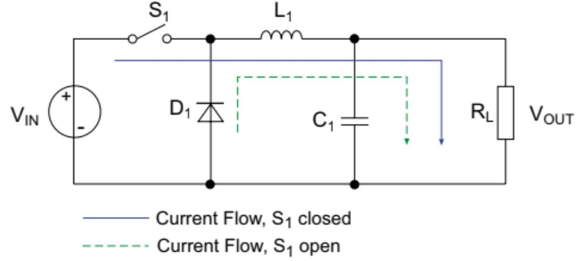

> **图注**：蓝色实线为 $S_1$ 闭合（导通）、绿色虚线为 $S_1$ 断开（续流）时的电感电流回路（外部资料）。

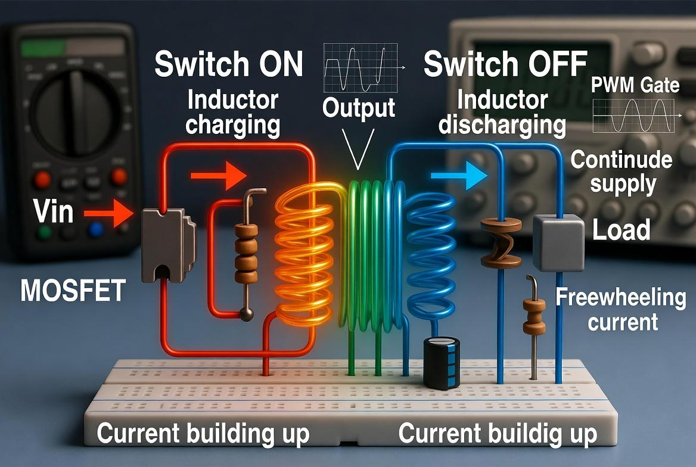

> **图注**：左侧 Switch ON / Inductor charging，右侧 Switch OFF / Freewheeling current，直观对应 1.2 的两个状态（外部资料）。

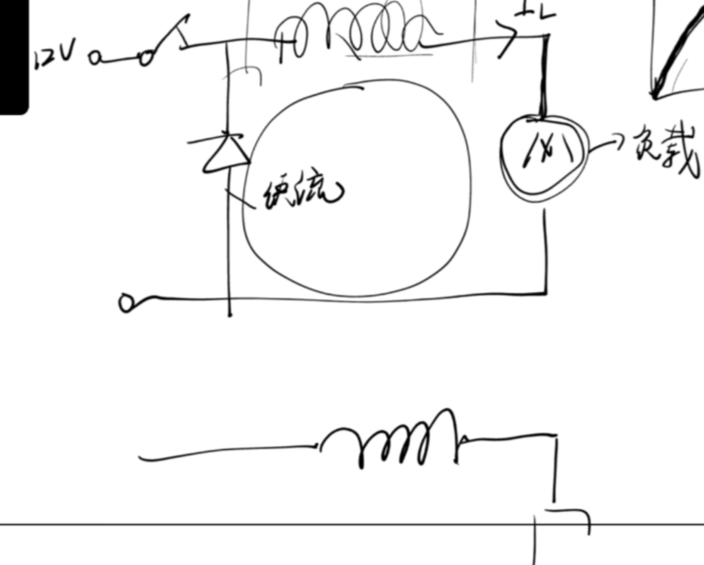

> **图注**：第五次培训手写图：12V 输入、电感 L、负载，二极管旁手写「续流」二字，正对应状态二的电流折返。

:::note[这里为什么先讲二极管]
第三次培训记录画的是二极管续流的经典 Buck 原理图，便于建立物理图像；第五次培训用的 SCT2450 是**同步** Buck，续流元件换成了低侧 MOSFET。两者的降压原理完全相同，区别在第二章展开，不要误以为两份材料互相矛盾。
:::

### 1.3 为什么输出电压会降低

假设 $V_{in}=12\text{V}$，MOS 管每个周期导通时间占 50%。开关节点电压如下：

| 时间 | MOSFET 状态 | 开关节点电压 |
| :--- | :--- | :--- |
| 前 50% | 导通 | 12V |
| 后 50% | 关断 | 0V |

一个周期内开关节点电压的平均值是：

$$ U_{\text{平均}} = 12 \times 50\% + 0 \times 50\% = 6\text{V} $$

MOS 管不断高速切换，电感与电容把这个脉冲电压平滑，输出就接近 6V。

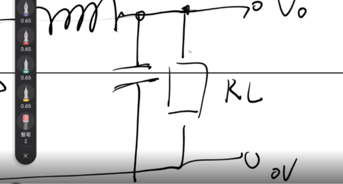

> **图注**：第五次培训手写图：电感、$R_L$ 与电容组成的输出滤波，电容让电压斜率变缓、抑制尖峰。
在理想 Buck、电感电流连续（CCM）的条件下，电压转换关系为：

$$ \boxed{U_o = D\,U_{in}} $$

其中 $D$ 是占空比，即导通时间占整个开关周期的比例；$U_o$ 为输出电压，$U_{in}$ 为输入电压。

:::derivation
**推导说明（伏秒平衡）：**

稳定工作时，一个完整周期内电感电流既不会一直增加，也不会一直减小，因此电感在一个周期内的电压平均值为 0：

$$ \overline{U_L} = 0 $$

导通期间电感电压为 $U_{in}-U_o$，持续 $DT$；关断期间为 $-U_o$，持续 $(1-D)T$。按时间加权求和：

$$ D(U_{in}-U_o) + (1-D)(-U_o) = 0 $$

展开并合并同类项：

$$ DU_{in} - DU_o - U_o + DU_o = DU_{in} - U_o = 0 $$

于是得到降压公式：

$$ \boxed{U_o = D\,U_{in}} $$
:::

占空比越小，输出电压越低：

| 输入电压 | 占空比 | 理想输出电压 |
| :--- | :--- | :--- |
| 12V | 25% | 3V |
| 12V | 50% | 6V |
| 12V | 75% | 9V |
| 24V | 50% | 12V |

:::important[最常见的误解]
Buck 并不是把 12V「分压」成 6V，也不是 MOS 管导通一半就直接把电压变成 6V。它是靠电感的储能、释能和电容的滤波，让输出端获得稳定的较低直流电压。
:::

#### 例题 1：12V 输入、占空比 50%，输出是多少？

**解：**

由 $U_o = D\,U_{in}$ 得：

$$ U_o = 0.5 \times 12 = 6\text{V} $$

也就是说开关节点在 12V 与 0V 之间跳变，经过 LC 滤波后输出约为 6V。若希望输出 5V，占空比应为：

$$ D = \frac{U_o}{U_{in}} = \frac{5}{12} \approx 41.7\% $$

* * *

## 二、 异步与同步整流：续流元件决定电路名字

### 2.1 一句话区分

区分同步降压（Synchronous Buck）与异步降压（Asynchronous Buck），**最简单的方法是看低侧续流元件是二极管还是 MOSFET**。核心区别在于：续流时，由谁维持电感电流？

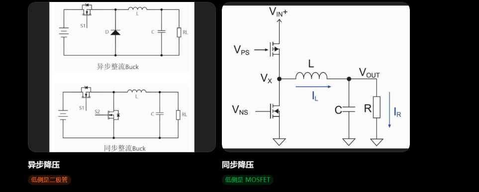

> **图注**：第五次培训配图：左侧「异步降压」低侧是二极管，右侧「同步降压」低侧是 MOSFET，并标出 $V_X$、$I_L$、$V_{OUT}$。

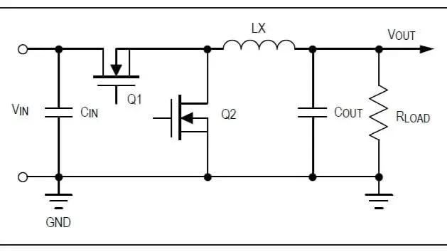

> **图注**：$Q_1$ 为高侧管、$Q_2$ 为低侧管，LX 节点接电感 $L$ 与 $C_{OUT}$（外部资料）。

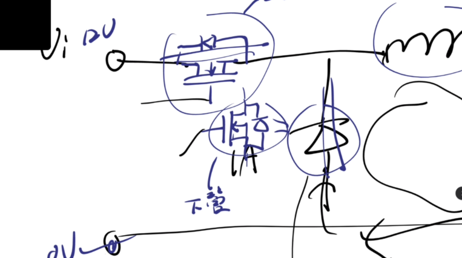

> **图注**：第五次培训手写图：蓝色笔迹圈出并标注「下管」，即用 MOSFET 替换续流二极管。

| | 异步 Buck | 同步 Buck |
| :--- | :--- | :--- |
| 上管 | MOSFET | MOSFET |
| 下管 / 续流元件 | 二极管 | MOSFET |
| 上管导通时 | 二极管截止，电感储能 | 下管关闭，电感储能 |
| 上管关断时 | 二极管续流 | 下管导通续流 |
| 控制复杂度 | 较低 | 较高（需要互补驱动与死区） |

### 2.2 为什么要用 MOSFET 换掉二极管

目的只有一个：**降低导通损耗，提高转换效率**。二极管的压降是固定的，电流越大损耗越大；MOSFET 的损耗由导通电阻决定。

异步 Buck 中二极管导通损耗：

$$ P_D = V_F I $$

取 $I=5\text{A}$、$V_F=0.5\text{V}$，可得：

$$ P_D = 0.5 \times 5 = 2.5\text{W} $$

同步 Buck 中低侧 MOSFET 的导通损耗：

$$ P_{MOS} = I^2 R_{DS(on)} $$

取 $I=5\text{A}$、$R_{DS(on)}=10\text{m}\Omega$，可得：

$$ P_{MOS} = 5^2 \times 0.01 = 0.25\text{W} $$

| 续流器件 | 示例条件 | 导通损耗 |
| :--- | :--- | :--- |
| 异步 Buck（二极管） | $I=5\text{A},\ V_F=0.5\text{V}$ | 2.5W |
| 同步 Buck（MOSFET） | $I=5\text{A},\ R_{DS(on)}=10\text{m}\Omega$ | 0.25W |

> **注意**：这里只比较续流器件的导通损耗，不代表整机总损耗。实际还要考虑开关损耗、驱动损耗等。同步 Buck 在大电流、低输出电压的场合通常更有优势。

:::caution[直通（Shoot-through）]
同步 Buck 的上下两个 MOSFET 绝不能同时导通，否则会形成从 $V_{in}$ 直接到地的直通电流，轻则大幅发热、效率骤降，重则烧毁芯片。实际控制中会在上下管切换时插入一小段**死区时间（Dead Time）**，先关上管、等待、再开下管。
:::

还有两个容易忽略的细节：

- 低侧 MOSFET 自带体二极管，死区期间可能由体二极管短暂续流，但正常工作时主要由 MOSFET 沟道续流。
- 同步 Buck 轻载时可能出现反向电流，有些控制器会采用二极管仿真模式避免电流反向。

:::important[最终记忆]
异步降压 = MOSFET + 二极管；同步降压 = MOSFET + MOSFET。
:::

* * *

## 三、 SCT2450：把典型应用电路逐引脚拆开

第三次培训里那张「常用的 buck 电源芯片」照片，是立创商城的 **SCT2450，ESOP-8 封装**；它在主板上用于 5V 模块和舵机模块。第五次培训则把它的整套典型应用电路从输入电源一直讲到输出负载。这一章把两者合在一起：先看清每个模块为什么存在，再落到具体参数。

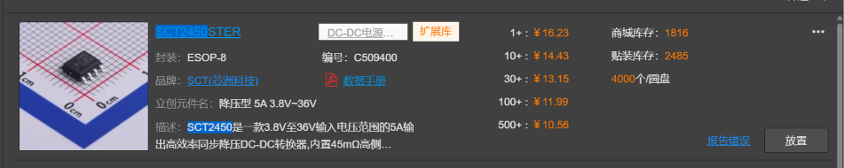

> **图注**：第三次培训记录 图 2：立创商城的 SCT2450，ESOP-8 封装，底部散热焊盘即 GND。

> **焊接提示（来自第三次记录）**：芯片底部是 GND，焊接时要放置焊膏、用热风枪；数据手册是纯英文，需要配合翻译软件阅读。

### 3.1 整体电路分成七个部分

SCT2450 内部已集成高侧 MOSFET 与低侧 MOSFET，因此它属于**同步 Buck**——第一章的二极管只是教学模型。

| 电路部分 | 主要元件 | 作用 |
| :--- | :--- | :--- |
| 输入滤波 | $C_{IN}$ | 稳定输入电源，提供瞬时脉冲电流 |
| 自举电路 | $C_{BOOT}$（原理图中的 C16） | 驱动内部高侧 MOSFET |
| 使能电路 | EN、R1、R2 | 控制芯片启动与输入欠压保护 |
| 频率设置 | RT、R3 | 设置开关频率 |
| 电压反馈 | FB、R5、R6 | 设置输出电压 |
| 环路补偿 | COMP、R4、C6、C7 | 保证输出稳定、不振荡 |
| 功率输出 | SW、L、$C_{OUT}$ | 实现降压与滤波 |

> **电路描述**：原记录图 3 是 SCT2450 数据手册的典型应用电路，标注为 **3.3V 输出**；第五次培训的推导则按 **12V 输入、5V 输出、2A 负载、500kHz** 展开。两者是同一套电路的不同输出电压实例，差别只在 FB 分压电阻，套用 3.6 节的公式即可换算，不要把它们当成两套设计。

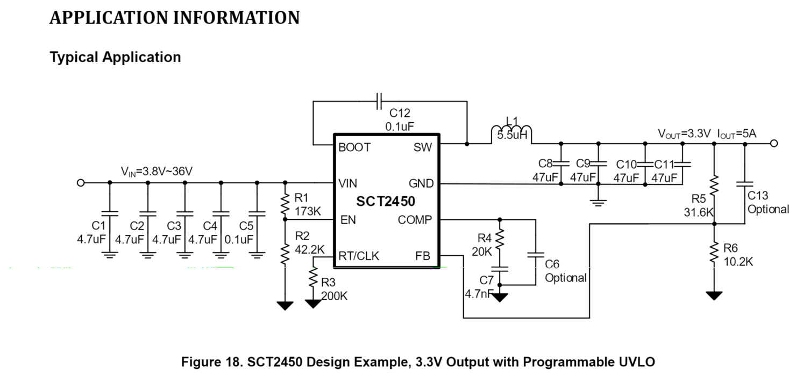

> **图注**：第三次培训记录 图 3 / 数据手册 Figure 18：$V_{IN}=3.8\text{V}\sim36\text{V}$、$V_{OUT}=3.3\text{V}$、$I_{OUT}=5\text{A}$，带可编程 UVLO。

从这张典型应用电路里可以直接读出整套参数，正好用来验证第三章的公式：

| 部分 | 图中取值 | 对应小节 |
| :--- | :--- | :--- |
| 输入滤波 | C1～C4 = 4.7μF ×4，C5 = 0.1μF | 3.2 |
| EN 分压（可编程 UVLO） | R1 = 173kΩ，R2 = 42.2kΩ | 3.4 |
| 频率设置 | R3 = 200kΩ → 500kHz | 3.5 |
| 自举电容 | C12 = 0.1μF，接 BOOT–SW | 3.3 |
| 功率级 | L1 = 5.5μH，C8～C11 = 47μF ×4，C13 可选 | 3.8 |
| FB 分压 | R5 = 31.6kΩ，R6 = 10.2kΩ | 3.6 |
| COMP 补偿 | R4 = 20kΩ，C7 = 4.7nF，C6 可选 | 3.7 |

代入 3.6 节的公式校验：$V_{OUT}=0.8\left(1+\frac{31.6}{10.2}\right)\approx3.28\text{V}$，与图上标注的 3.3V 一致；R3 = 200kΩ 也与 3.5 节的 500kHz 对应。

:::note[两套参考设计别混用]
上图是手册 Figure 18 的 **3.3V / 5A** 设计（L1 = 5.5μH、R4 = 20kΩ、C7 = 4.7nF）；3.7 节表里的 R4 = 33.2kΩ、C7 = 3.3nF、L1 = 7.8μH 是另一套 **5V** 参考设计。补偿网络与电感、输出电容必须整套配套使用，不要交叉拼凑。
:::

### 3.2 输入滤波：VIN 旁边为什么放好几个电容

Buck 的 MOSFET 是高速开关器件：高侧导通时输入电源要向电感供电，关断时输入电流突变，因此芯片输入端存在**高频脉冲电流**。若没有输入电容，这些脉冲电流只能经较长的电源线取得，线路寄生电感就会产生电压尖峰与噪声。

输入电容的四个作用：

1. 高侧 MOSFET 导通瞬间提供瞬时电流。
2. 开关状态变化时缓冲输入电压波动。
3. 减少高频电流流经外部电源线。
4. 降低 EMI。

数据手册参考设计用了 4 个 4.7μF 电容并联 1 个 0.1μF 电容。不同容值负责不同频段：

| 电容 | 主要作用 | 布局要求 |
| :--- | :--- | :--- |
| 4.7μF ×4 | 储能与中低频滤波 | 靠近 VIN |
| 0.1μF | 滤除高频开关噪声 | 尽量紧贴 VIN 与 GND 引脚 |

:::warning[别只看标称容量]
陶瓷电容存在**直流偏压效应**：标称容量在实际工作电压下会明显下降。选型时要查有效容量，顺带校核耐压与纹波电流。
:::

### 3.3 自举电容 CBOOT：为什么需要比 VIN 更高的电压

这是第三次培训里反复强调「越近越好」的 C16（100nF），也就是第五次培训里的 $C_{BOOT}=0.1\mu\text{F}$——**同一个元件，两种叫法**。

问题从高侧 N 沟道 MOSFET 的位置说起：漏极接 $V_{in}$，源极接 SW。MOSFET 导通看的是栅源电压：

$$ V_{GS} = V_G - V_S $$

假设需要约 5V 的 $V_{GS}$ 才能充分导通。当 SW 升到 12V 时，栅极就得有 17V，可芯片输入只有 12V。自举电路解决的就是这件事：

**阶段一（低侧导通，充电）**：SW 被拉到接近 0V，内部充电电路给 BOOT–SW 之间的电容充到约 5V，即 $V_{BOOT}-V_{SW}=5\text{V}$。

**阶段二（高侧导通，抬高）**：SW 从 0V 升到 12V，电容两端电压不会突然消失，于是 BOOT 电位随之抬升：

$$ V_{BOOT} = V_{SW} + 5\text{V} = 12\text{V} + 5\text{V} = 17\text{V} $$

| 位置 | 电压 |
| :--- | :--- |
| SW | 12V |
| BOOT | 17V |
| BOOT 与 SW 之间 | 5V |

:::tip[自举的比喻]
不是凭空造出 17V，而是先在地面放一个 5m 高的台阶，再把整个台阶抬到 12m——台阶高度没变，顶部自然到了 17m。这也是「拎着自己鞋带把自己提起来」这个名字的由来。
:::

数据手册明确要求：

$$ \boxed{C_{BOOT} = 0.1\mu\text{F}} $$

建议 X5R 或更好的陶瓷电容、耐压至少 10V。

:::warning[接线位置]
这个电容必须接在 **BOOT 与 SW 之间**，不是 BOOT 与 GND 之间。它给高侧驱动器提供的是一个能跟随 SW 一起浮动的电源。
:::

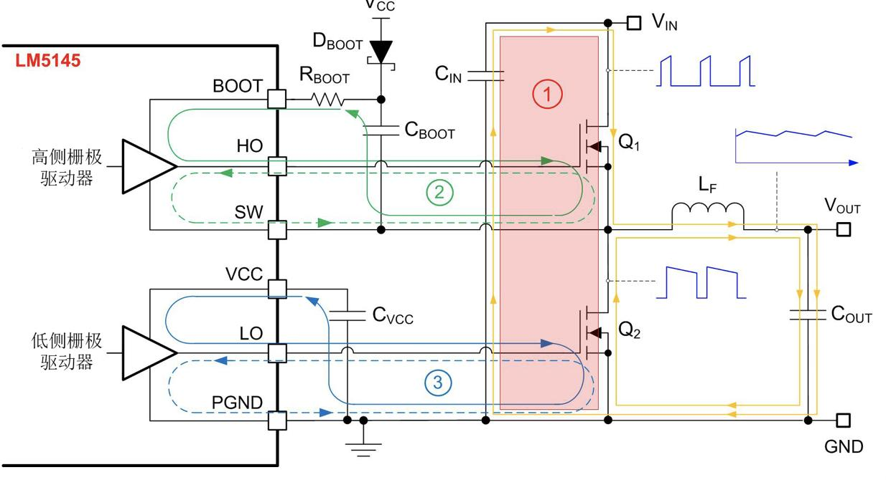

> **图注**：LM5145 半桥驱动示意：BOOT / $D_{BOOT}$ / $R_{BOOT}$ / $C_{BOOT}$ 组成自举供电，标出的 ①②③ 是三个需要尽量小的高频回路（外部资料）。

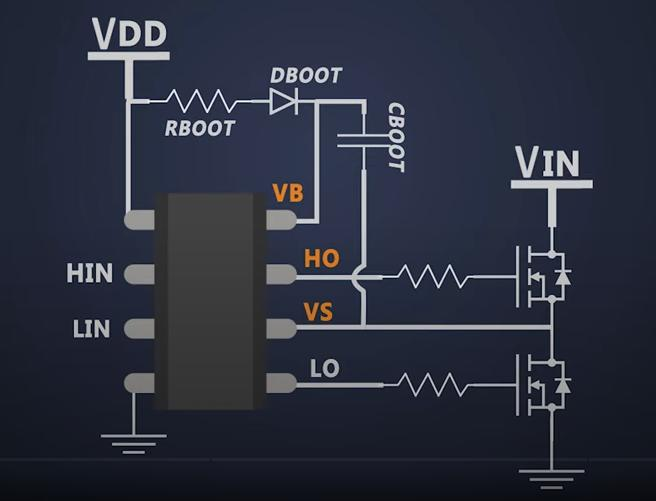

> **图注**：$V_{DD}\to R_{BOOT}\to D_{BOOT}\to C_{BOOT}$，驱动器 VB / HO / VS / LO 引脚与高低侧 MOSFET 的连接（外部资料）。

### 3.4 EN：使能，不是调压脚

EN 决定芯片是否开始工作：电压高于约 1.18V 允许启动，低于约 1.1V 关闭转换器。通过 R1、R2 分压，可以设定「输入电压到多少才允许启动」：

$$ V_{EN} = V_{IN}\frac{R_2}{R_1+R_2} $$

例如希望输入低于 6V 不启动、达到 6V 以上才工作，就可以按上式配分压比。若不需要自定义欠压阈值，按手册建议把 EN 接 VIN 即可。

:::warning[常见记错]
SCT2450 的 EN 引脚带内部上拉电流，精确的启动 / 关闭电压要用数据手册给的公式计算，不能只用普通分压公式。**EN 控制的是芯片是否工作，不是输出电压大小**——输出电压由 FB 分压决定。
:::

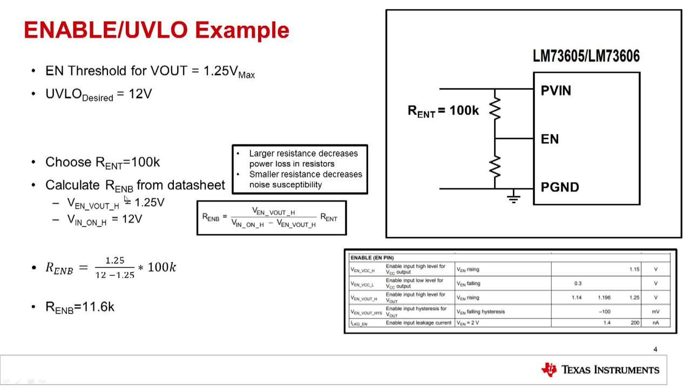

> **图注**：TI LM73605/06 的 ENABLE/UVLO 计算示例（$R_{ENT}=100\text{k}\Omega$、$R_{ENB}=11.6\text{k}\Omega$、$UVLO=12\text{V}$）。**这是另一颗芯片的示例，仅用来说明分压计算方法，不是 SCT2450 的参数**。

### 3.5 RT/CLK：一个电阻定频率

$$ \boxed{R_T(\text{k}\Omega) = \frac{100000}{f_{SW}(\text{kHz})}} $$

例如选 $f_{SW}=500\text{kHz}$：

$$ R_T = \frac{100000}{500} = 200\text{k}\Omega $$

开关频率会影响电感电流纹波、输出纹波、电感与电容体积、开关损耗和整机效率：

| 开关频率 | 优点 | 缺点 |
| :--- | :--- | :--- |
| 较低 | 开关损耗较低 | 电感、电容体积可能较大 |
| 较高 | 外围元件可以更小 | 开关损耗与发热可能增加 |

SCT2450 支持 100kHz～2.2MHz，也支持外部时钟同步；初次设计用 RT 电阻设置即可。

### 3.6 FB：芯片怎么知道输出该是 5V

芯片并不知道「输出应该是 5V」，它只做一件事：让 FB 引脚电压等于内部基准。

$$ \boxed{V_{REF} = 0.8\text{V}} $$

R5 接 VOUT 与 FB，R6 接 FB 与 GND，分压为：

$$ V_{FB} = V_{OUT}\frac{R_6}{R_5+R_6} $$

芯片不断调节占空比使 $V_{FB}=0.8\text{V}$，于是：

$$ V_{OUT} = 0.8\left(1+\frac{R_5}{R_6}\right) $$

反解出上臂电阻：

$$ \boxed{R_5 = \left(\frac{V_{OUT}}{0.8}-1\right)R_6} $$

以手册建议的 $R_6=10.2\text{k}\Omega$、目标 5V 为例：

$$ R_5 = \left(\frac{5}{0.8}-1\right)\times 10.2\text{k}\Omega = 53.55\text{k}\Omega $$

取标准阻值 $R_5=53.6\text{k}\Omega$。

**负反馈是怎样自动纠错**：若输出跌到 4.8V，

$$ V_{FB} = 4.8\times\frac{10.2}{53.6+10.2} \approx 0.767\text{V} $$

低于 0.8V 基准，芯片就增加供能；输出偏高则减少供能；合适则维持。这就是一个自动纠错系统。

### 3.7 COMP：负反馈为什么会振荡，怎么补偿

如果「电压低了立刻猛加占空比、电压高了立刻猛减」，系统会来回过冲：

1. 输出低了 → 大幅增加供能；
2. 输出超过目标 → 大幅减少供能；
3. 输出再次下降 → 如此反复。

COMP 引脚外接的 R4（补偿电阻）、C7（补偿电容）、C6（可选高频补偿电容）共同调整环路增益与相位，兼顾响应速度与稳定性。R4 与 C7 形成一个补偿零点：

$$ f_{Z1} = \frac{1}{2\pi R_4 C_7} $$

C6 形成额外的高频极点，用于补偿输出电容 ESR 的影响：

$$ f_{P3} = \frac{1}{2\pi R_4 C_6} $$

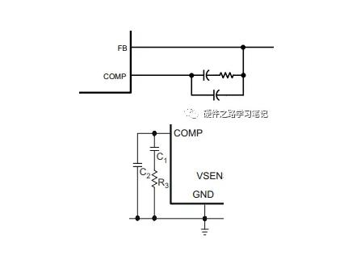

> **图注**：FB / COMP 之间的电阻电容补偿网络示意，对应 3.7 节的 $R_4$、$C_7$、$C_6$（外部资料）。

数据手册在 500kHz、5V 输出下的参考设计：

| 元件 | 参数 |
| :--- | :--- |
| R4 | 33.2kΩ |
| C7 | 3.3nF |
| C6 | 22pF（可选） |
| L1 | 7.8μH |
| $C_{OUT}$ | 4 × 47μF |

:::warning[参考设计不是万能值]
这组参数配套的是手册里的 7.8μH 电感与 4×47μF 输出电容。若改成 10μH 电感或别的输出电容，必须重新核算补偿网络，并用负载瞬态测试确认稳定性。**初学阶段先照抄手册完整参考设计，不要随意改 R4、C7**。C6 是否安装还要看输出电容及其 ESR。
:::

### 3.8 SW、电感与输出电容：真正完成降压的功率级

SW 是开关节点，接外部电感：

- **上管导通**：$V_{in} \to \text{MOSFET} \to SW \to L \to V_{out}$，电感电流上升、储能。
- **下管导通**：电感经低侧 MOSFET 续流，继续向负载供能。

输出电容负责三件事：平滑电感电流造成的输出纹波、负载突增时临时供电、负载突减时吸收多余能量。输出电压纹波主要由电容 ESR 与电容充放电两部分构成，手册给出的陶瓷电容近似公式：

$$ \Delta V_{OUT} = \frac{V_{OUT}(V_{IN}-V_{OUT})}{8f_{SW}^2 L C_{OUT} V_{IN}} $$

由此可以看出：电感越大、输出电容越大、开关频率越高，输出纹波越小。

> **注意**：手册参考设计用 4 个 47μF 输出电容，但 2A 负载不一定需要照搬，应按有效容量、负载瞬态要求与允许纹波确定。

### 3.9 GND 与散热焊盘、以及芯片自带的保护

SCT2450 是 ESOP-8 封装，芯片底部有一个裸露散热焊盘（第三次记录里称「第 9 脚」），它不只是散热结构，**还与 GND 电气连接**。PCB 上必须可靠焊接到地平面、多个过孔连接到底层地铜，绝不能让底部焊盘变成孤岛。

芯片内部还有两类保护：

- **软启动**：约 4ms，上电时输出从 0V 逐渐上升，降低冲击电流与输出过冲。
- **过流 / 过温**：监测上下管电流，过载时逐周期限流，故障持续则进入打嗝模式（Hiccup），故障消失后自动重新软启动；结温过高时停止开关，降温后重启。

### 3.10 12V→5V / 2A 设计参数清单

综合两份材料给出的条件：

$$ V_{IN}=12\text{V},\quad V_{OUT}=5\text{V},\quad I_{OUT(max)}=2\text{A},\quad f_{SW}=500\text{kHz} $$

| 项目 | 值 |
| :--- | :--- |
| 芯片工作模式 | 同步 Buck（SCT2450） |
| 输入电压 | 12V |
| 输出电压 | 5V |
| 最大输出电流 | 2A |
| 开关频率 | 500kHz |

| 元件 | 初步选择 | 作用 |
| :--- | :--- | :--- |
| L1 | 10μH | 储能、平滑电流 |
| R3（RT） | 200kΩ | 设置 500kHz |
| R5 | 53.6kΩ | 输出反馈上臂 |
| R6 | 10.2kΩ | 输出反馈下臂 |
| CBOOT / C16 | 0.1μF（100nF） | 高侧驱动自举 |
| $C_{IN}$ | 4×4.7μF + 0.1μF | 输入滤波 |
| $C_{OUT}$ | 待计算 | 输出滤波 |
| R4、C7、C6 | 待确定 | 环路补偿 |
| EN | 接 VIN 或分压 | 使能、欠压保护 |

> **注意**：这是初步清单。输入 / 输出电容还要校核耐压、有效容量、纹波电流与瞬态性能；补偿网络按 3.7 节重新核算。第三次培训还给出一条设计约定：**电感按 12V 输入条件设计，峰峰值纹波 $I_{Lpp}$ 取约 0.3 倍**；第五次培训把它写成 $LIR=\Delta I_L/I_{OUT(max)}\approx30\%$。两处说的是同一个经验取舍，本文统一采用 4.3 节的 LIR 定义（以最大输出电流为基准）。

* * *

## 四、 电感电流纹波与选型

### 4.1 什么是电感电流纹波

Buck 工作时电感电流不是一条水平直线，而是上下波动的三角波：上管导通时电流增大，下管导通时电流减小。一个周期内最大值与最小值之差称为**峰峰值纹波** $\Delta I_L$：

$$ \boxed{\Delta I_L = I_{Lmax} - I_{Lmin}} $$

例如平均电流 3A、最大 3.6A、最小 2.4A，则 $\Delta I_L = 1.2\text{A}$。

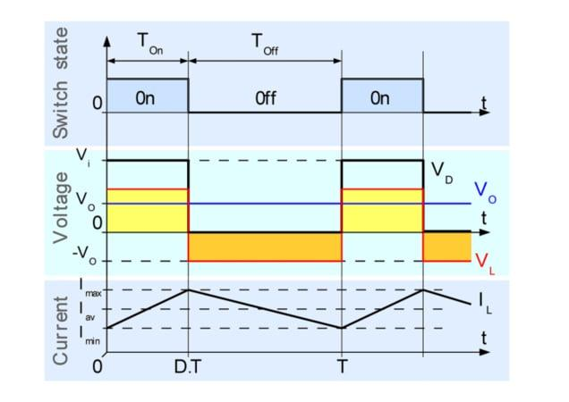

> **图注**：自上而下：开关状态 $T_{on}/T_{off}$、电感电压（导通时 $V_i-V_o$，关断时 $-V_o$）、三角波电感电流 $I_{max}/I_{av}/I_{min}$，横轴标出 $D T$ 与 $T$（外部资料）。
注意这是**峰峰值**，不是「上下各波动多少」。

### 4.2 纹波公式怎么来的

从 $U_L = L\dfrac{di_L}{dt}$ 出发，导通期间：

$$ \Delta I_L = \frac{U_L \Delta t}{L} = \frac{(V_{IN}-V_{OUT})DT}{L} $$

再由 $T=1/f_{SW}$ 与 $D=V_{OUT}/V_{IN}$ 整理可得：

$$ \boxed{\Delta I_L = \frac{V_{OUT}}{L f_{SW}}\left(1-\frac{V_{OUT}}{V_{IN}}\right)} $$

:::derivation
**推导说明（纹波公式）：**

由电感电压关系，导通期间 $\Delta t = DT$：

$$ \Delta I_L = \frac{(V_{IN}-V_{OUT})DT}{L} $$

代入 $T=1/f_{SW}$：

$$ \Delta I_L = \frac{(V_{IN}-V_{OUT})D}{L f_{SW}} $$

再代入理想 Buck 的 $D=V_{OUT}/V_{IN}$：

$$ \Delta I_L = \frac{(V_{IN}-V_{OUT})V_{OUT}}{L f_{SW} V_{IN}} = \frac{V_{OUT}}{L f_{SW}}\left(1-\frac{V_{OUT}}{V_{IN}}\right) $$

这就是纹波公式，也是反推电感量的依据：

$$ L = \frac{V_{OUT}\left(1-\dfrac{V_{OUT}}{V_{IN}}\right)}{f_{SW}\Delta I_L} $$
:::

### 4.3 LIR 与 30% 经验值

纹波系数定义为纹波占最大输出电流的比例：

$$ \boxed{LIR = \frac{\Delta I_L}{I_{OUT(max)}}} $$

工程上常取 20%～40%，30% 是常用折中。例如 $I_{OUT(max)}=3\text{A}$、LIR=30%，则 $\Delta I_L=0.9\text{A}$，电流在 3A 上下各摆 0.45A（最大 3.45A、最小 2.55A）。

| 纹波系数 | 电感量 | 电流纹波 | 特点 |
| :--- | :--- | :--- | :--- |
| 20% | 较大 | 较小 | 电流更平稳 |
| 30% | 适中 | 适中 | 常用折中 |
| 40% | 较小 | 较大 | 电感可能更小 |

纹波过大会抬高峰值电流，增加电感饱和风险以及 MOSFET、电容的电流应力。

#### 例题 2：12V→5V、500kHz、10μH，纹波有多大？

**解：**

代入第四章公式：

$$ \Delta I_L = \frac{5}{10\mu\text{H}\times 500\text{kHz}}\left(1-\frac{5}{12}\right) $$

先算分母 $L f_{SW} = 10\times10^{-6}\times 5\times10^{5} = 5$，再算括号 $1-5/12 \approx 0.583$，于是：

$$ \Delta I_L = \frac{5\times 0.583}{5} \approx 0.58\text{A} $$

对 2A 满载而言 $LIR \approx 0.58/2 \approx 29\%$，正好落在 30% 附近——这也解释了为什么 10μH 与 500kHz 能凑成一套自洽的选型。

补充一个直观斜率校验：上管导通时 $U_L=12-5=7\text{V}$，$\dfrac{di_L}{dt}=\dfrac{7}{10\mu\text{H}}=0.7\text{A}/\mu\text{s}$；下管导通时 $U_L=0-5=-5\text{V}$，$\dfrac{di_L}{dt}=-0.5\text{A}/\mu\text{s}$。

#### 例题 3：电感从 5μH 换成 10μH，纹波怎么变？

**解：** 由 $\Delta I_L \propto 1/L$，其他条件不变时电感量加倍，纹波变为原来的一半，选 **A**。

:::tip[三个公式要连起来记]
$U_L=L\dfrac{di}{dt}$ 是物理规律 → $\Delta I_L=\dfrac{U_L\Delta t}{L}$ 是纹波来源 → $L=\dfrac{V_{OUT}(1-V_{OUT}/V_{IN})}{f_{SW}\Delta I_L}$ 才是选型公式。理解这条链，换任何 DC-DC 降压芯片都能自己算电感。
:::

* * *

## 五、 PCB 布局实操：从原理图到铺铜

第三次培训记录的后半段是纯实操，配了十几张截图。这一章把截图里的信息全部转成文字与表格，并补上第五次培训给出的物理原因。

### 5.1 布局前的三条准备

:::caution[前提中的前提]
**PCB 布局前一定要确保原理图是正确的，不然后面全是空谈。** 常见原理图错误见培训群内文件。
:::

1. **封装选择**：新手建议用 0805，比 0603 好焊接（原记录图 6 是两种封装的大小对比，左 0603、右 0805）。
2. **交叉选择**：在原理图里框选整个模块，按 `Shift+X` 可切换到 PCB（需先打开 PCB 文件）；反过来也能从 PCB 切回原理图。
3. **先看参考布局**：官方推荐的 PCB 参考布局优先照着摆；没有官方参考时再依据经验。自己画的布局里那些铺铜区域是用来走大电流的，初学看不懂可以先跳过。

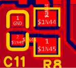

> **图注**：第三次培训记录 图 6：左为 0603、右为 0805，新手优先选 0805 更好焊接。

原记录里还有一张「PCB 布局设计六步走」的示意图，它讲的是**通用布局原则**，并不是电源专有的功率回路六步：

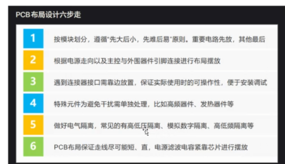

> **图注**：第三次培训记录 图 7：六条通用布局原则，适用于各类电路板。

1. 按模块划分，遵循「先大后小、先难后易」，重要电路先放，其他最后。
2. 根据电源走向，以及主控与外围器件的引脚连接来摆放。
3. 连接器接口靠边放置，保证实际使用时的可操作性，便于安装调试。
4. 高频器件、发热器件等特殊元件单独处理，避免干扰。
5. 做好电气隔离：高低压隔离、模拟数字隔离、高低频隔离等。
6. 走线尽可能短、直，电源滤波电容紧靠芯片摆放。

而落到这块 Buck 板子的实际画图，是下面这 10 步。

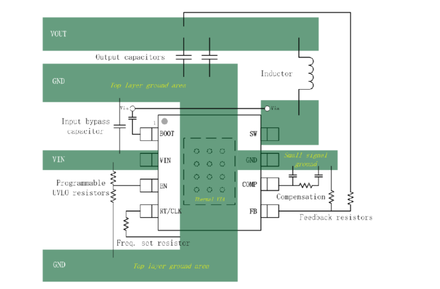

> **图注**：第三次培训记录 图 4：优先照官方参考布局摆放元器件。

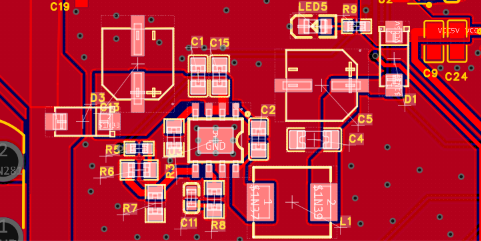

> **图注**：第三次培训记录 图 5：作者自画的布局，部分区域铺铜用来走大电流。

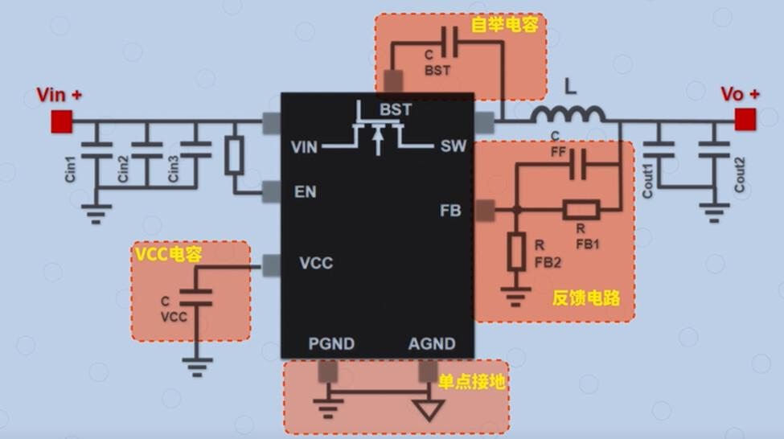

> **图注**：标注了自举电容、VCC 电容、反馈电路与 PGND / AGND 单点接地的位置关系（外部资料）。

### 5.2 十步布局流程

| 步骤 | 做什么 | 要点 / 原因 |
| :--- | :--- | :--- |
| 1 | 按模块划分元器件 | 同一模块的元件放一起，用 `Shift+X` 交叉选择 |
| 2 | 放置芯片 | 按模块作用选位置，优先照官方参考布局 |
| 3 | 输入滤波电容由小到大 | 最小容值最靠近芯片引脚，依次向外递增 |
| 4 | 自举电容紧贴芯片 | C16（100nF）越近越好、走线越短越好 |
| 5 | 完成输入输出部分 | 后续元件连接按原理图布局推进 |
| 6 | 芯片底部 GND | 底部是第 9 脚 GND，绝不能做成孤岛 |
| 7 | 线宽与过孔 | 信号线细、电源线宽；过孔尺寸与线宽一致 |
| 8 | 铺铜 | 走线过粗时用铺铜处理，设置改成直连 |
| 9 | 反馈回路 | FB 走线尽量短 |
| 10 | LED 与其余走线 | LED 一般最后放，线宽默认；其余线宽看作用，靠经验 |

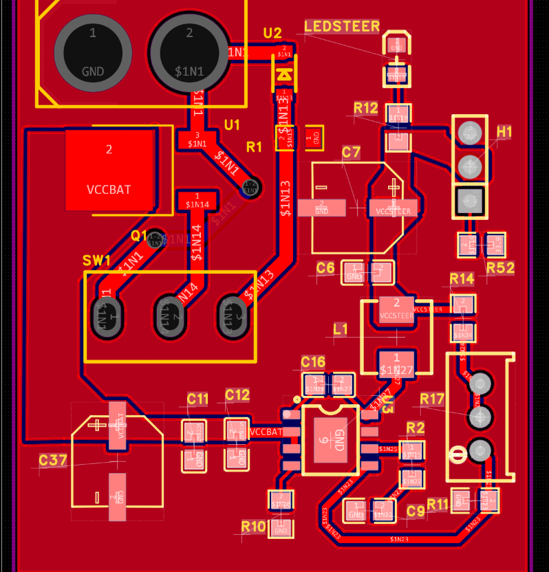

> **图注**：第三次培训记录 图 12：完成输入滤波、自举、功率级后的整体摆放效果。

:::caution[反复强调的两条]
**不要直角转弯**；**芯片底部 GND 不要做成孤岛**。这两条在培训记录里是被单独框出来强调的。
:::

### 5.3 关键步骤背后的物理原因

**输入滤波电容由小到大**：原理图上电容的排列顺序其实对应 PCB 位置。小容值（0.1μF）负责滤高频开关噪声，只有离 VIN/GND 引脚最近，寄生电感才足够小；大容值负责储能与中低频滤波，可以依次向外放。

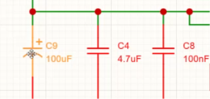

> **图注**：第三次培训记录 图 8：最小容值最靠近芯片引脚。

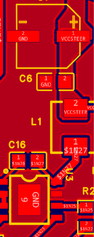

> **图注**：第三次培训记录 图 9：原理图上的电容顺序对应到 PCB 上的实际位置。

**自举电容（C16 / CBOOT）为什么必须贴着芯片**：

> 原记录把这段解释放在一个高亮框里：C16 可以当成一个「小充电宝」。芯片内部高侧开关管需要比输入电压更高的电压才能打开，C16 就是提供这个额外高压的。每次开关瞬间它都要瞬间吐出很大的电流；走线一长，就像水管太长太细，寄生电感会让电流跟不上、充放电变慢，还会引发剧烈的电压震荡（振铃），既损耗能量、干扰其他电路，严重时可能瞬间击穿芯片。

这与 3.3 节的 17V 栅极驱动需求是同一件事的两面：**原理上要一个浮动电源，布局上就要最短回路**。

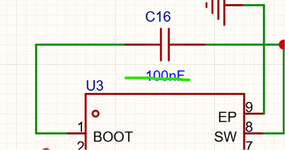

> **图注**：第三次培训记录 图 10：原理图中需要重点关注的 C16。

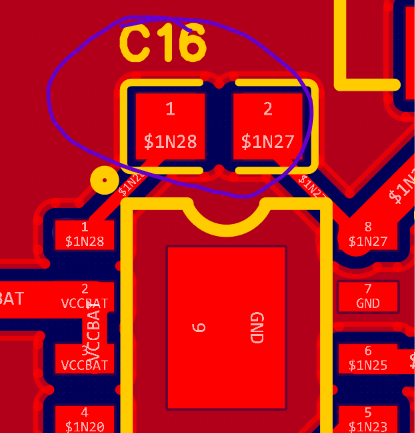

> **图注**：第三次培训记录 图 11：越近越好、走线越短越好。

**芯片底部 GND 的两种处理**：

1. 推荐：专门在铜皮上留一个缺口，让底部焊盘与外面的 GND 相连（原记录图 13）。
2. 备选：PCB 两面铺铜再打过孔连到底层地平面（较麻烦，培训里不建议）。

第五次培训给出的通用 PCB 原则与此一致：散热焊盘可靠焊接到地平面、底层铺完整 GND 铜皮、多个过孔连接、输入电容靠近 VIN/GND、电感靠近 SW、RT/FB/COMP 等小信号走线远离 SW、功率地与信号地合理规划。

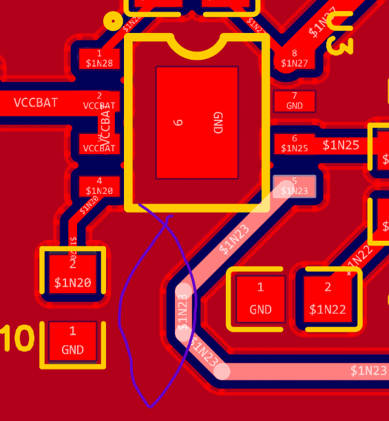

> **图注**：第三次培训记录 图 13：推荐的散热焊盘接法。

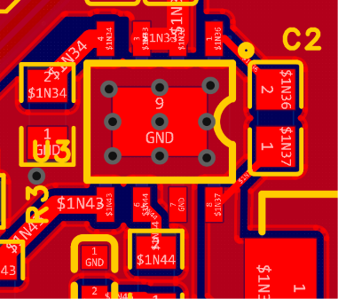

> **图注**：第三次培训记录 图 14：另一种接法，较麻烦，培训中不建议。

:::warning[SW 节点别乱铺铜]
SW 是高速跳变节点，电压变化剧烈、EMI 强，铜皮不能无节制铺大，否则会增加寄生电容与 EMI。这与「功率回路要短而宽」并不矛盾：要短，但不要肥。
:::

**线宽与过孔**：信号线细、电源线宽。培训截图里的线宽设计建议表按 1oz（35μm）与 2oz（70μm）两种铜厚，列出不同线宽在温升 10°C / 20°C / 30°C 下的载流能力；图旁给出的经验关系是 **地线 > 电源线 > 信号线**，常见取值为信号线 0.2～0.3mm（8～12mil）、最细 0.05～0.07mm（2～2.8mil）、电源线 1.2～2.5mm（48～100mil）。信号线宽与过孔要成对选择（如 8/8mil 配 12mil / 0.3mm 过孔，6/6mil 配 12mil / 0.3mm，4/4mil 配 8mil / 0.2mm），换算关系是 $0.025\text{mm}=1\text{mil}$。打过孔时记得同步更新过孔尺寸、与线宽一致；具体载流仍要按实际铜厚、允许温升和计算工具核算，不要凭感觉估大电流路径。

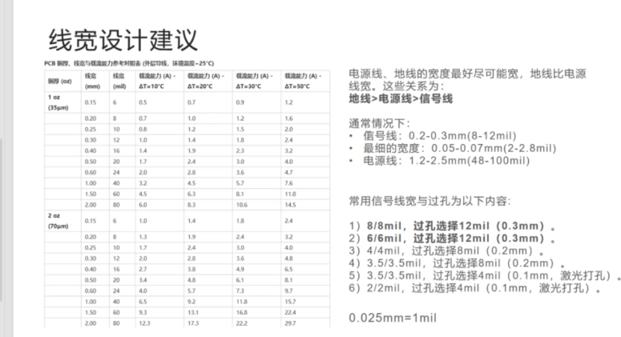

> **图注**：第三次培训记录 图 15：1oz / 2oz 铜厚下的线宽与载流能力对照，右侧附有信号线、电源线与过孔选配建议。

**铺铜**：走线过粗时改用铺铜（矩形 / 圆形 / 多边形），铺铜前把设置改成**直连**；铺铜同样不要直角。

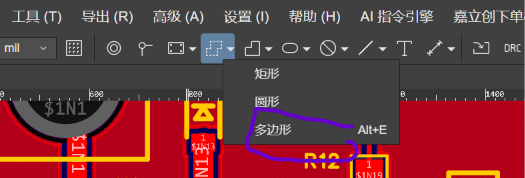

> **图注**：第三次培训记录 图 16：EDA 软件里的铺铜工具入口。

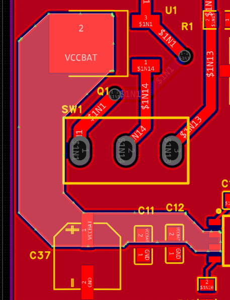

> **图注**：第三次培训记录 图 17：走线过粗时改用铺铜的实际效果。

**反馈回路**：FB 是小信号、高阻抗节点，走线要短，且远离 SW 开关节点，避免大电流回路干扰反馈信号（呼应 3.6 节的负反馈）。

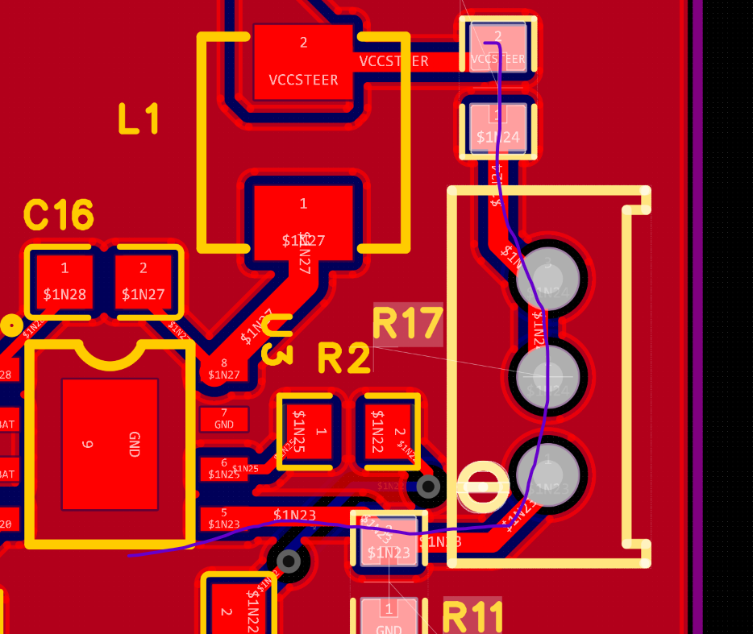

> **图注**：第三次培训记录 图 18：PCB 上 C16、L1、R17 与 FB 反馈走线的实际位置。

> **原记录的收尾说明**：后续课程讲的是「为什么必须这样布局」的原理，内容较复杂就没有继续记录，可看培训回放。本文 5.3 节与第三章正是把这部分原理补回来。

* * *

## 六、 H 桥与 Boost：别把半桥和拓扑混为一谈

### 6.1 H 桥是什么

> **电路描述**：四个功率开关管组成两个桥臂，形状像字母 H。Q1、Q2 是左臂上管与下管，Q3、Q4 是右臂上管与下管；直流电机 M 接在两个桥臂中点之间；VCC 接在桥臂顶端，桥臂底端接地。实际电路用 MOSFET 而不是小信号三极管，因为电机启动与堵转电流很大。

H 桥的核心作用是：**通过控制开关管改变电机两端电压极性，从而控制正反转。**

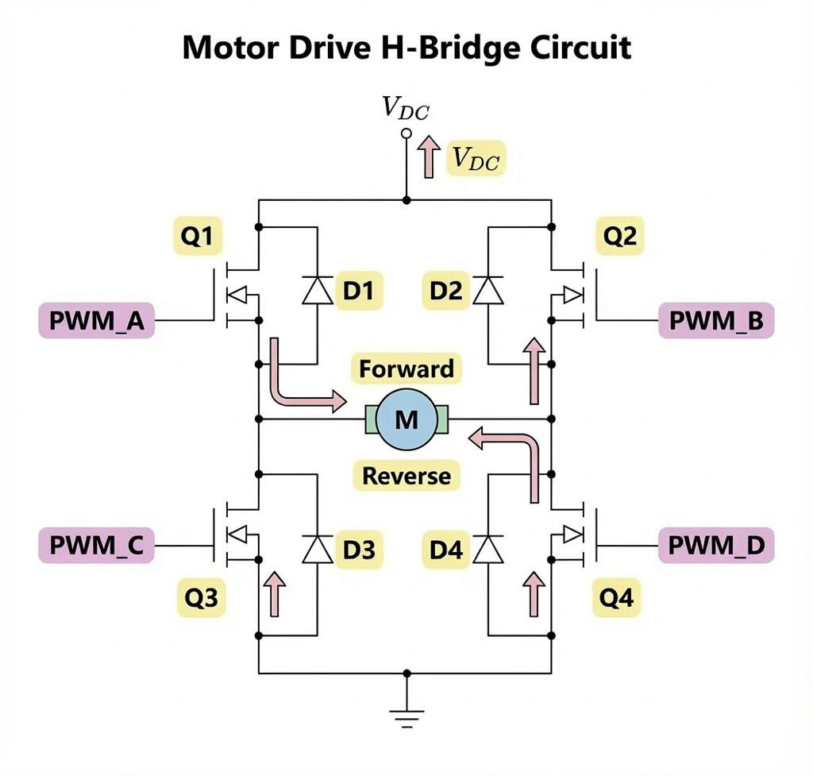

> **图注**：Q1～Q4 四个 MOSFET、D1～D4 续流二极管、PWM_A～D 四路驱动，图中箭头分别标出 Forward 与 Reverse 电流方向（EdrawMax）。

- **正转**：Q1、Q4 导通，Q2、Q3 关断，电流路径 $VCC \to Q1 \to M \to Q4 \to GND$，电机两端电压 $U_M = VCC$。
- **反转**：Q3、Q2 导通，Q1、Q4 关断，电流路径 $VCC \to Q3 \to M \to Q2 \to GND$，此时 $U_M = -VCC$。

:::important[规律]
对角线上的两个 MOSFET 同时导通，电机沿一个方向转；换另一组对角线，电机反转。
:::

### 6.2 四种基本状态与制动

| Q1 | Q2 | Q3 | Q4 | 工作状态 |
| :--- | :--- | :--- | :--- | :--- |
| 1 | 0 | 0 | 1 | 正转 |
| 0 | 1 | 1 | 0 | 反转 |
| 0 | 0 | 0 | 0 | 滑行（Coast） |
| 1 | 0 | 1 | 0 | 制动（Brake，高侧方式） |

1 表示导通，0 表示关断。

- **滑行**：四个管子全关，电机与电源断开，靠惯性慢慢停。
- **制动**：让电机两端等电位（例如两个下管 Q2、Q4 同时导通，或如表所示两个上管 Q1、Q3 同时导通），此时 $U_M=0$。电机转动产生的反电动势会经导通的 MOSFET 与电机形成回路，产生制动力矩，停得更快。

:::note[原记录里看似矛盾的地方]
第五次培训的状态表写的是「Q1、Q3 导通」制动，正文举例却是「Q2、Q4 导通」制动。两者其实都成立：只要电机两端被接到同一电位就能制动，高侧制动与低侧制动都可以。具体用哪种逻辑要看驱动芯片数据手册。
:::

> **注意**：虽然制动时电机两端电压为零，但电机内部仍然有电流。

### 6.3 PWM 调速

PWM 通过周期性导通与关断改变电机获得的平均电压：

$$ U_{avg} = D \times VCC $$

以 12V 供电为例：

| PWM 占空比 | 理想平均电压 |
| :--- | :--- |
| 25% | 3V |
| 50% | 6V |
| 75% | 9V |
| 100% | 12V |

例如 $D=50\%$ 时 $U_{avg}=0.5\times12=6\text{V}$。这是简化的理想分析，实际转速还受负载、绕组电阻、电感与反电动势影响。

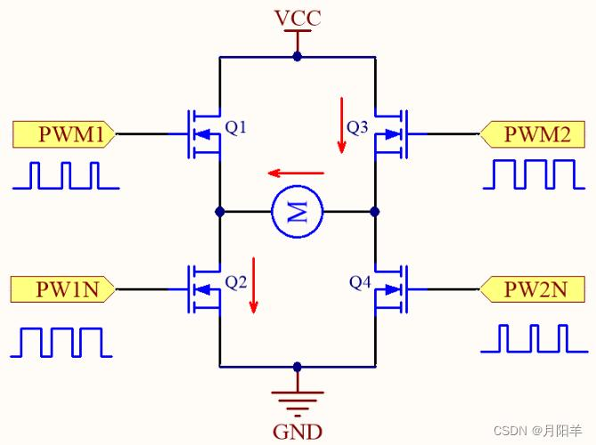

> **图注**：Q1～Q4 分别由 PWM1 / PWM2 / PW1N / PW2N 控制，红箭头标出桥臂电流方向（CSDN）。

常见两种实现：固定一个上管、用 PWM 控制对侧下管（正转时 Q1 常通、Q4 输入 PWM）；或者直接用 TB6612FNG、DRV8833 这类集成驱动芯片提供的 PWM 输入脚。智能车里一般用集成芯片而不是自己搭四个 MOSFET：

| 芯片 | 特点 |
| :--- | :--- |
| TB6612FNG | 双路直流电机驱动，支持正反转与 PWM，小型智能车常用 |
| DRV8833 | 双路 H 桥，支持直流电机与步进电机，低压应用广 |
| L298N | 经典双 H 桥，内部为双极型功率晶体管，压降与发热较大，适合学原理 |

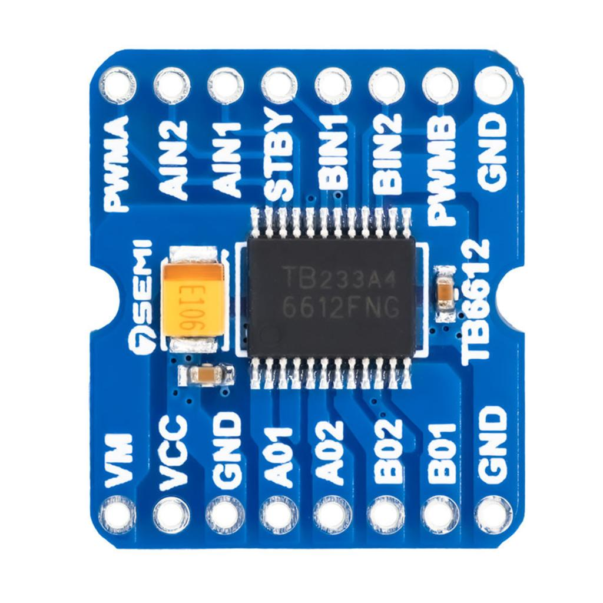

> **图注**：蓝色模块，引脚含 PWMA、AIN1、AIN2、STBY、BIN1、BIN2、PWMB、VM、VCC、AO1～BO2。

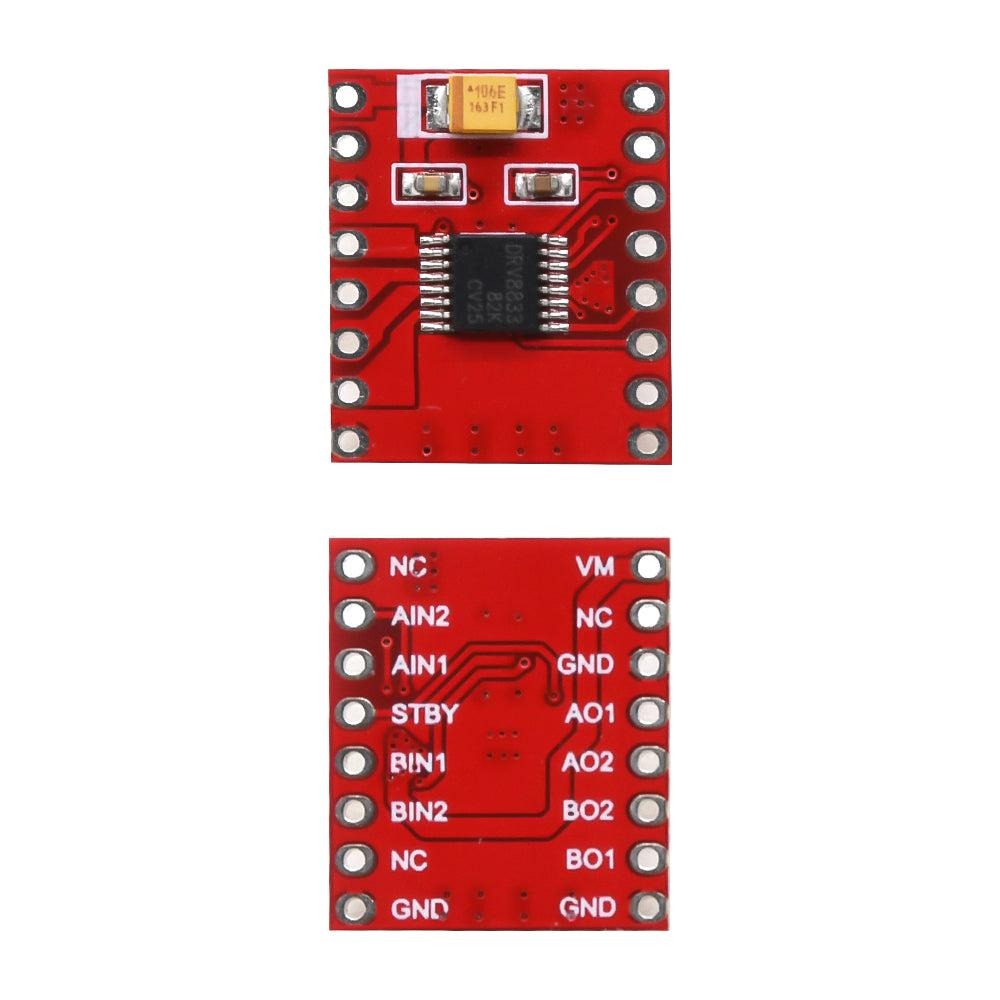

> **图注**：红色模块正反面，引脚含 AIN1/AIN2、BIN1/BIN2、STBY、AO1/AO2、BO1/BO2。

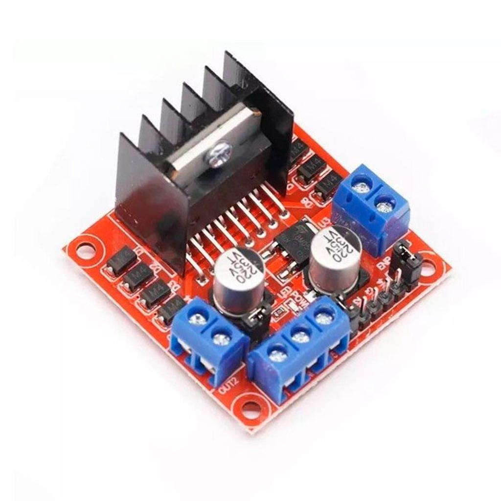

> **图注**：带大型散热片的经典双 H 桥模块，压降与发热较大。

### 6.4 直通与死区（和同步 Buck 是同一个问题）

若同一桥臂的 Q1、Q2 同时导通，电流路径变成 $VCC \to Q1 \to Q2 \to GND$，不经过电机，形成电源到地的短路，即**直通（Shoot-through）**：瞬间大电流、MOSFET 快速发热，严重时直接烧毁。

防止办法是插入死区时间：先关 Q1 → 等待一小段 $t_{dead}>0$ → 再开 Q2。实际死区要根据 MOSFET 开关速度与驱动器延迟确定。此外还要考虑栅极驱动电压、栅极充放电能力、高侧驱动方式与体二极管续流路径。

> **对照记忆**：同步 Buck 的上下管直通、H 桥同臂上下管直通，本质都是「半桥两管同时导通」，对策都是死区时间。

### 6.5 半桥 ≠ 升降压：Buck / Boost / Buck-Boost

SCT2450 内部确实是一个半桥：上管漏极接 VIN、源极接 SW，下管漏极接 SW、源极接 GND，即 $VIN \to Q1 \to SW \to Q2 \to GND$。上管导通 $V_{SW}\approx V_{IN}$，下管导通 $V_{SW}\approx 0$，SW 因此输出高速 PWM 脉冲。

在 SW 后面接电感和电容，就是 Buck：12V 输入、$D=50\%$ 时 SW 平均值为 6V，经 LC 滤波后 $V_{OUT}\approx 6\text{V}$。

Boost 的结构完全不同：**输入电源先经过电感，再连接开关节点**（$V_{IN}\to L\to SW$），SW 再经 MOSFET 接地、经二极管接输出。

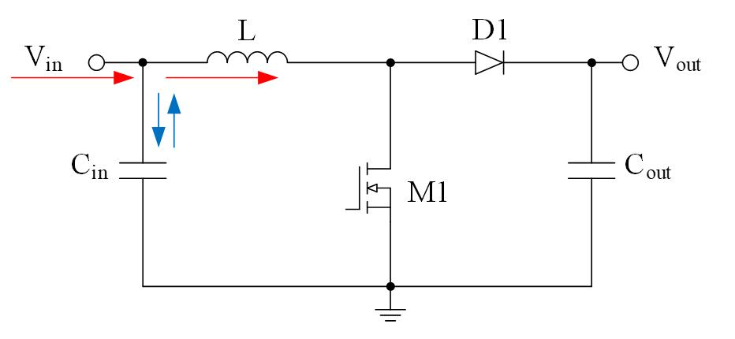

> **图注**：$V_{in}\to L\to D_1\to V_{out}$，$M_1$ 为对地开关，$C_{in}$ / $C_{out}$ 分别接输入输出（MPS）。

- MOSFET 导通：SW 被拉到接近 GND，二极管截止，电感储能，输出电容维持负载。
- MOSFET 关断：电感不允许电流突变，产生感应电压与输入电压叠加，经二极管向输出供能，于是 $V_{OUT}>V_{IN}$。

因此**半桥只是功率开关结构，不决定升降压**；电感的位置与外围功率回路才决定拓扑。SCT2450 的半桥是为 Buck 功率级设计的，不能仅靠改外部电感接法就变成标准 Boost。

需要同时升降压时用 Buck-Boost（通常四个 MOSFET + 一个电感）：

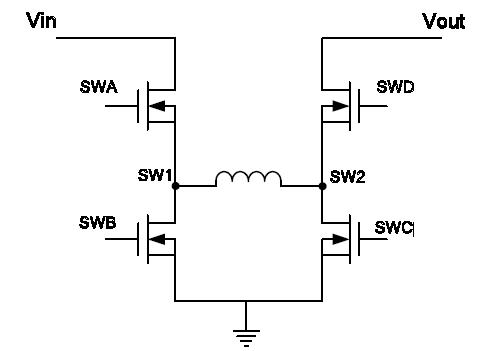

> **图注**：SWA～SWD 四个 MOSFET 与中间电感，SW1 / SW2 为两个开关节点（MPS MP8859 资料）。

| 输入输出关系 | 工作状态 |
| :--- | :--- |
| $V_{IN} > V_{OUT}$ | 降压 |
| $V_{IN} < V_{OUT}$ | 升压 |
| $V_{IN} \approx V_{OUT}$ | 升降压过渡 |

这在智能车电源里很实用：电池电压随放电下降，但某些模块仍要稳定 5V。

#### 例题 4：Boost 输入 5V，为什么输出能达到 8V？

**解：** 选 **A**。MOSFET 关断时电感释放能量，产生的感应电压与输入电压叠加后向输出供电。MOSFET 导通并不会「放大」电压，输出电容也不会凭空增加电压。

:::important[最值得记住的一句]
半桥决定开关节点如何切换，电感的位置和外围功率回路决定转换器究竟是 Buck 还是 Boost。
:::

* * *

## 七、 总结与注意事项

### 7.1 核心公式速查

| 概念 | 公式 | 说明 |
| :--- | :--- | :--- |
| 理想 Buck 电压关系 | $U_o = D\,U_{in}$ | CCM、理想器件，来自伏秒平衡 |
| 电感基本规律 | $u_L = L\dfrac{di_L}{dt}$ | 纹波与选型的物理起点 |
| 电感电流纹波 | $\Delta I_L = \dfrac{V_{OUT}}{L f_{SW}}\left(1-\dfrac{V_{OUT}}{V_{IN}}\right)$ | 峰峰值 |
| 电感选型 | $L = \dfrac{V_{OUT}(1-V_{OUT}/V_{IN})}{f_{SW}\Delta I_L}$ | 由目标纹波反推 |
| 纹波系数 | $LIR = \dfrac{\Delta I_L}{I_{OUT(max)}}$ | 常取 20%～40% |
| 二极管续流损耗 | $P_D = V_F I$ | 异步 Buck |
| MOS 续流损耗 | $P_{MOS}=I^2R_{DS(on)}$ | 同步 Buck |
| 开关频率电阻 | $R_T(\text{k}\Omega)=\dfrac{100000}{f_{SW}(\text{kHz})}$ | SCT2450 |
| 输出电压设定 | $V_{OUT}=0.8\left(1+\dfrac{R_5}{R_6}\right)$ | $V_{REF}=0.8\text{V}$ |
| FB 分压 | $V_{FB}=V_{OUT}\dfrac{R_6}{R_5+R_6}$ | 负反馈检测点 |
| 补偿零点 / 极点 | $f_{Z1}=\dfrac{1}{2\pi R_4C_7}$，$f_{P3}=\dfrac{1}{2\pi R_4C_6}$ | COMP 环路补偿 |
| 输出纹波 | $\Delta V_{OUT}=\dfrac{V_{OUT}(V_{IN}-V_{OUT})}{8f_{SW}^2LC_{OUT}V_{IN}}$ | 陶瓷电容近似 |
| H 桥平均电压 | $U_{avg}=D\times VCC$ | PWM 调速理想模型 |
| 高侧驱动电压 | $V_{BOOT}=V_{SW}+V_{CBOOT}$ | 自举电容浮动供电 |

### 7.2 易错点提醒

1. **Buck 不是分压**：靠电感储能释能 + 电容滤波，不是把 12V「分」成 6V。
2. **二极管与 MOS 管续流不矛盾**：前者是异步 Buck 的教学模型，SCT2450 是同步 Buck，用低侧 MOSFET 续流。
3. **EN 不是调压脚**：它决定芯片是否工作；输出电压由 FB 分压决定，且 EN 有内部上拉电流，精确阈值要用手册公式。
4. **CBOOT 接 BOOT–SW，不是 BOOT–GND**：0.1μF（= C16 100nF），X5R 或更好、耐压 ≥10V。
5. **上下管绝不能同时导通**：同步 Buck 与 H 桥都要留死区时间。
6. **3.3V 典型应用 vs 5V 自设计**：同一套电路、不同 FB 电阻，别当成两份互相冲突的参数。
7. **手册补偿参数有前提**：R4/C7/C6 那组值配套 7.8μH + 4×47μF，改电感或输出电容要重算并做瞬态测试。
8. **陶瓷电容有直流偏压效应**：标称容量不等于实际有效容量，还要校核耐压与纹波电流。
9. **芯片底部 GND 不能成孤岛**：它是散热焊盘也是电气地，必须连到地平面。
10. **原理图和布局两条红线**：原理图先正确；走线不要直角转弯。
11. **SW 铜皮不是越大越好**：高速跳变节点，铺太大会增加寄生电容与 EMI。
12. **H 桥制动表格与正文不矛盾**：两端等电位即可制动，高低侧两种方式都成立，以芯片手册为准。
13. **30% 是峰峰值纹波占比**：不是电流上下各波动 30%。

### 7.3 设计与学习顺序

1. **理解功率回路**：$V_{in}\to$ MOSFET $\to SW\to$ 电感 $\to$ 输出电容 $\to$ 负载，先弄明白能量怎么传递。
2. **确定输出电压**：计算 FB 分压电阻 R5、R6。
3. **确定开关频率**：由 RT/CLK 选 R3，权衡体积与开关损耗。
4. **计算电感与电容**：算电流纹波、输出纹波与电容电流，按 LIR≈30% 定电感。
5. **设计补偿网络**：选 R4、C7、C6，保证环路稳定。
6. **绘制 PCB**：按第 5 章十步走，优先照官方参考布局，注意 GND、线宽、FB 与 SW。
7. **上电测试**：测输出电压、SW 波形、输出纹波与负载瞬态响应。

> **官方资料**：SCT2450 Rev.2.2 数据手册，重点读第 8～18 页的工作原理与应用设计，以及第 21 页的 PCB 布局建议。

:::tip[学习建议]
先把 $U_o=DU_{in}$ 从伏秒平衡推一遍，再用 $\Delta I_L$ 公式把 10μH / 500kHz / 5V 这套参数自己算一遍，最后回到 PCB 上问自己「每个元件离芯片多远、为什么」。原理、计算、布局三件事能对上号，这块电源就算真正拿下了。
:::
