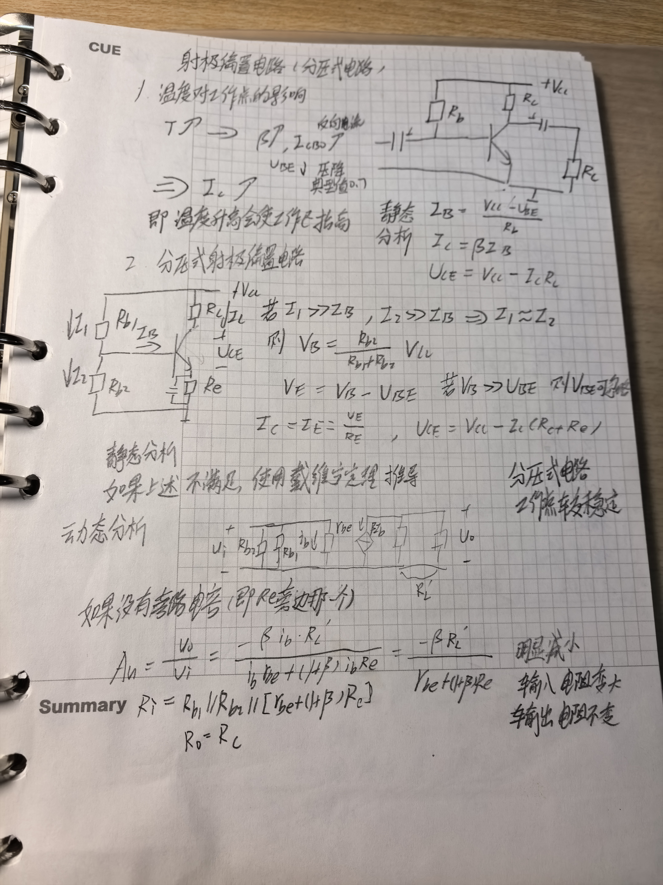
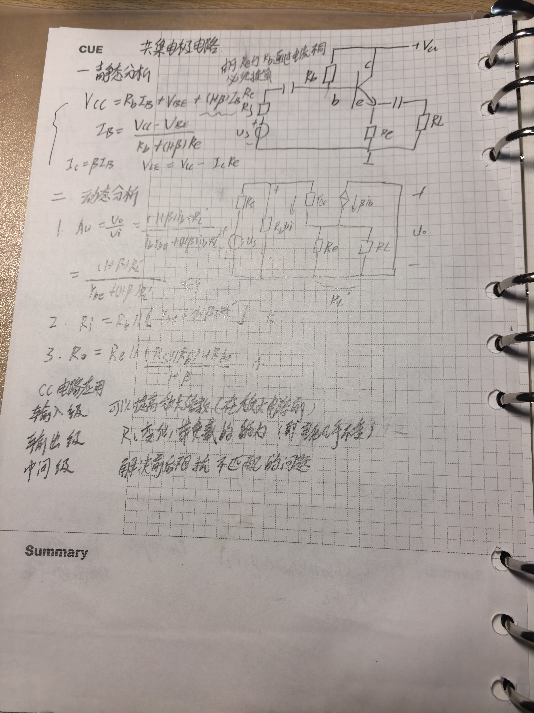
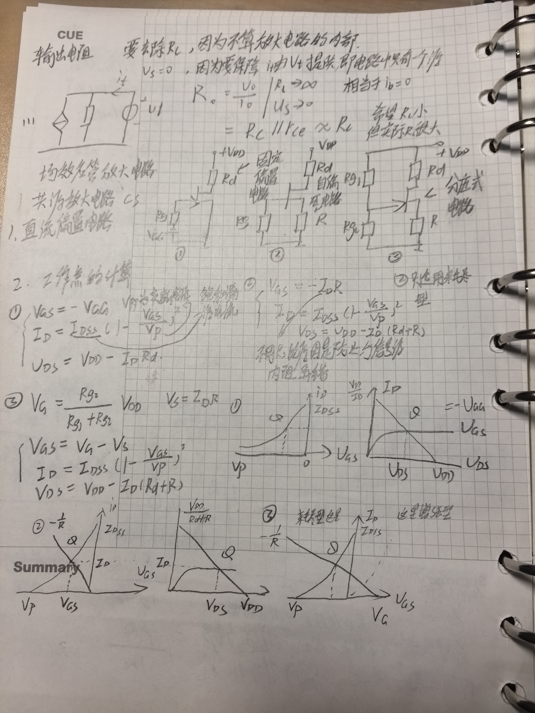
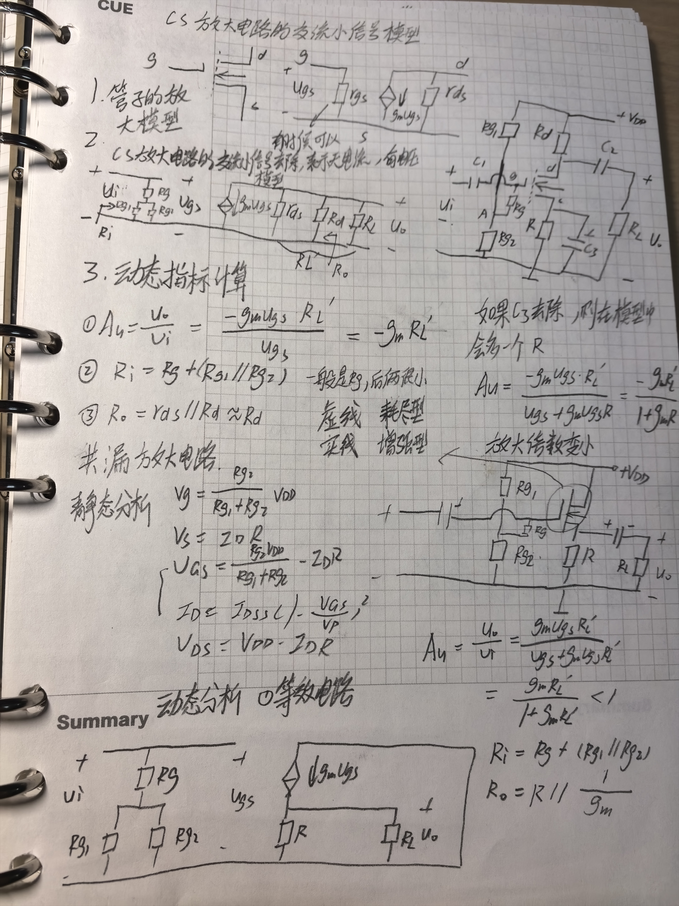

# 单管放大电路：射极偏置、共集电极与场效应管放大

> **导语**：这是模电「基本放大电路」的核心内容。第一部分讲三极管放大电路：用**分压式射极偏置电路**解决静态工作点的温度稳定性问题，再介绍**共集电极电路**（射极输出器）高输入电阻、低输出电阻的特点。第二部分转向**场效应管放大电路**：共源（CS）与共漏放大。全部以原手写笔记图为主，每图配详细注释与公式转写。

* * *

## 第一部分　双极型晶体管（BJT）放大电路

### 一、分压式射极偏置电路（稳定静态工作点）

> **电路描述**：电源 $V_{CC}$ 经基极电阻 $R_{B1}$（上）与 $R_{B2}$（下）分压，中点接三极管基极 b；集电极经 $R_C$ 接 $V_{CC}$；发射极经 $R_E$ 接地，并在 $R_E$ 两端并联旁路电容 $C_E$；输出端经耦合电容接负载 $R_L$。

> **图注**：原笔记第 1 页。左侧是「温度对 Q 点的影响」因果链，中部是分压式射极偏置电路图与静态分析公式，下方是动态分析的微变等效电路与电压增益、输入/输出电阻公式。

#### 1.1 注释①：温度为什么会破坏静态工作点？

图中最上方的因果链：

$$ T\uparrow \;\Rightarrow\; \beta\uparrow,\; I_{CBO}\uparrow,\; U_{BE}\downarrow \;\Rightarrow\; I_C\uparrow $$

- **温度升高 → $\beta$ 增大**：电流放大系数随温度上升而变大。
- **温度升高 → $I_{CBO}$ 增大**：集电结反向饱和电流由少子漂移形成，对温度极敏感。
- **温度升高 → $U_{BE}$ 下降**：硅管发射结压降约按 $-2\,\mathrm{mV}/^\circ\mathrm{C}$ 减小。

三者共同推高 $I_C$，Q 点向饱和区移动，甚至失真。图中手写标注「放大电流」「β 增大」正是此意。

> **注意**：$U_{BE}$ 下降在固定偏置里尤其致命——$I_B=(V_{CC}-U_{BE})/R_B$，$U_{BE}$ 减小使 $I_B$ 增大，再被 $\beta$ 放大，双重推高 $I_C$。

#### 1.2 注释②：基本射极偏置电路的静态分析（对比用）

带 $R_E$ 的基本电路静态公式：

$$ I_B = \frac{V_{CC}-U_{BE}}{R_B},\qquad I_C = \beta I_B,\qquad U_{CE} = V_{CC} - I_C R_C $$

引入 $R_E$ 后有直流负反馈：$I_C\uparrow \Rightarrow I_E\uparrow \Rightarrow V_E\uparrow \Rightarrow U_{BE}\downarrow \Rightarrow I_B\downarrow$，抑制 $I_C$ 上升。但稳定性有限，于是引出分压式结构。

#### 1.3 注释③：分压式射极偏置——静态分析

当满足 **$I_1 \gg I_B$、$I_2 \gg I_B$** 时，$I_1 \approx I_2$，基极电位由分压比决定：

$$ V_B = \frac{R_{B2}}{R_{B1}+R_{B2}}\,V_{CC} $$

$$ V_E = V_B - U_{BE} $$

若进一步满足 **$V_B \gg U_{BE}$**，则 $V_E \approx V_B$，进而：

$$ I_C \approx I_E = \frac{V_E}{R_E},\qquad U_{CE} = V_{CC} - I_C(R_C + R_E) $$

**稳定关键**：$I_C$ 由 $V_E/R_E$ 决定，而 $V_E$ 不随温度变，Q 点稳定。

:::tip[稳定机理一句话]
分压固定 $V_B$，$R_E$ 把 $V_B$ 转成 $I_E\approx I_C$；温度想推高 $I_C$，却被这层直流负反馈压回去。
:::

> **重要**：笔记标注「如果上述不满足，使用戴维宁定理推导」。当 $I_B$ 不能忽略时，把 $R_{B1}$、$R_{B2}$ 做戴维宁等效：$V_{BB}=\dfrac{R_{B2}}{R_{B1}+R_{B2}}V_{CC}$，$R_{BB}=R_{B1}\parallel R_{B2}$，再代入 $I_B=\dfrac{V_{BB}-U_{BE}}{R_{BB}+(1+\beta)R_E}$。

#### 1.4 注释④：动态分析（有旁路电容）

有 $C_E$ 时发射极交流接地，$R_L'=R_C\parallel R_L$：

$$ A_u = \frac{u_o}{u_i} = \frac{-\beta R_L'}{r_{be}} $$

$$ R_i = R_{B1}\parallel R_{B2}\parallel r_{be},\qquad R_o = R_C $$

#### 1.5 注释⑤：动态分析（无旁路电容）

去掉 $C_E$，$R_E$ 在交流通路里引入负反馈：

$$ A_u = \frac{-\beta R_L'}{r_{be}+(1+\beta)R_e} $$

$$ R_i = R_{B1}\parallel R_{B2}\parallel\big[\,r_{be}+(1+\beta)R_e\,\big],\qquad R_o = R_C $$

笔记右侧小结：**增益减小、输入电阻变大、输出电阻不变**。

:::note[旁路电容 $C_E$ 的作用]
有 $C_E$：增益大（$-\beta R_L'/r_{be}$），输入电阻小。
无 $C_E$：增益小、输入电阻大，稳定性与线性度更好。
按需取舍。
:::

### 二、共集电极电路（射极输出器 CC）

> **电路描述**：集电极直接接电源 $V_{CC}$（交流接地），输入从基极经耦合电容送入，输出从发射极经耦合电容取出，发射极电阻 $R_E$ 兼作负载端。

> **图注**：原笔记第 2 页。上方是共集电极电路图与基极回路电压方程，中部是动态分析的微变等效电路和 $A_u$、$R_i$、$R_o$ 公式，下方是 CC 电路的三大应用。

#### 2.1 注释①：静态分析

基极回路 KVL：

$$ V_{CC} = I_B R_B + V_{BE} + (1+\beta)I_B R_E $$

注意 $I_E=(1+\beta)I_B$，故 $R_E$ 上压降为 $(1+\beta)I_B R_E$。解出：

$$ I_B = \frac{V_{CC}-V_{BE}}{R_B+(1+\beta)R_E},\qquad I_C = \beta I_B,\qquad V_{CE} = V_{CC} - I_C R_E $$

#### 2.2 注释②：动态分析——电压增益

$R_L'=R_E\parallel R_L$，输出取自发射极：

$$ A_u = \frac{(1+\beta)R_L'}{r_{be}+(1+\beta)R_L'} \lesssim 1 $$

增益为正（输出与输入同相）且接近 1，无电压放大作用，主要做起阻抗变换。

#### 2.3 注释③：输入电阻与输出电阻

$$ R_i = R_B \parallel \big[\, r_{be} + (1+\beta)R_L' \,\big] $$

基极看进去，发射极电阻被折算放大 $(1+\beta)$ 倍，$R_i$ 很大。

$$ R_o = R_E \parallel \frac{(R_S\parallel R_B)+r_{be}}{1+\beta} $$

令输入信号为零，从发射极往里看，基极回路电阻被缩小 $(1+\beta)$ 倍，$R_o$ 很小。

#### 2.4 注释④：CC 电路的三大应用

| 位置 | 作用 | 原理 |
| :--- | :--- | :--- |
| **输入级** | 提高输入电阻 | $R_i$ 大，减轻对信号源的索取 |
| **输出级** | 增强带负载能力 | $R_o$ 小，接负载后电压几乎不掉 |
| **中间级** | 解决前后阻抗不匹配 | 高入阻、低出阻，起缓冲隔离作用 |

:::important[共集电极电路三特点]
**输入电阻高、输出电阻低、电压增益小于且接近 1（同相）**。
常被放在多级放大器的输入级、输出级或中间级做阻抗匹配，而不是用来放大电压。
:::

### 三、本篇小结与易错点

| 电路 | $A_u$ | $R_i$ | $R_o$ |
| :--- | :--- | :--- | :--- |
| 分压式射极偏置（有 $C_E$） | $-\beta R_L'/r_{be}$ | $R_{B1}\parallel R_{B2}\parallel r_{be}$ | $R_C$ |
| 分压式射极偏置（无 $C_E$） | $-\beta R_L'/[r_{be}+(1+\beta)R_e]$ | $R_{B1}\parallel R_{B2}\parallel[r_{be}+(1+\beta)R_e]$ | $R_C$ |
| 共集电极（射极输出器） | $(1+\beta)R_L'/[r_{be}+(1+\beta)R_L']$ | $R_B\parallel[r_{be}+(1+\beta)R_L']$ | $R_E\parallel\dfrac{(R_S\parallel R_B)+r_{be}}{1+\beta}$ |

**易错点**：静态看直流通路、动态看交流通路；共射 $R_L'=R_C\parallel R_L$、共集 $R_L'=R_E\parallel R_L$；共集 $A_u$ 为正且小于 1；分压条件不满足时用戴维宁等效。

* * *

## 第二部分　场效应管（FET）放大电路

### 一、通用问题：输出电阻怎么求？

> **图注**：原笔记第 3 页。上方是「输出电阻」求法，中部是三种直流通路（自给偏压、分压式偏置等），下方是工作点计算与特性曲线图解。

#### 1.1 注释①：为什么求 $R_o$ 时要去掉 $R_L$、令 $u_s=0$

- **去掉 $R_L$**：$R_o$ 是放大器本身的输出电阻，负载不属于放大器。
- **令 $u_s=0$**：求输出电阻时令输入信号为零，控制量为零，受控源不起作用。

$$ R_o = \left.\frac{u_o}{i_o}\right|_{u_s=0} = R_C \parallel r_{ce} \approx R_C $$

:::note[求 $R_o$ 的三步]
① 移去负载 $R_L$；② 令独立信号源为零；③ 输出端加试探电压 $u$、求电流 $i$，$R_o=u/i$。
:::

### 二、共源放大电路（CS）：直流通路与 Q 点

#### 2.1 注释②：三种直流通路

- **自给偏压**：栅极经 $R_G$ 接地，源极串 $R_S$；利用 $I_D$ 在 $R_S$ 上的压降形成负 $V_{GS}$，适合耗尽型管。
- **分压式偏置**：$R_{G1}$、$R_{G2}$ 分压提供正偏压，源极仍有 $R_S$，增强型/耗尽型都适用。

#### 2.2 注释③：自给偏压电路的 Q 点

$$ V_{GS} = -I_D R_S,\qquad I_D = I_{DSS}\left(1 - \frac{V_{GS}}{V_P}\right)^2,\qquad V_{DS} = V_{DD} - I_D R_D $$

联立肖克莱方程解 $I_D$。图解法：转移特性曲线与直线 $V_{GS}=-I_D R_S$ 的交点即 Q 点。

#### 2.3 注释④：分压偏置电路的 Q 点

$$ V_G = \frac{R_{G2}}{R_{G1}+R_{G2}}\,V_{DD},\qquad V_S = I_D R_S $$

$$ V_{GS} = V_G - I_D R_S,\qquad I_D = I_{DSS}\left(1 - \frac{V_{GS}}{V_P}\right)^2 $$

$$ V_{DS} = V_{DD} - I_D(R_D + R_S) $$

:::tip[肖克莱方程的适用]
$I_D=I_{DSS}(1-V_{GS}/V_P)^2$ 适用于**结型场效应管与耗尽型 MOS 管**，且 $V_P\le V_{GS}\le 0$。增强型 MOS 管用 $I_D=K(V_{GS}-V_{GS(th)})^2$。
:::

### 三、共源放大电路：小信号模型与动态指标

> **图注**：原笔记第 4 页。上半部分是场效应管放大模型、CS 微变等效电路及三个动态指标；下半部分是共漏放大电路的静态与动态分析。

#### 3.1 注释⑤：管子的放大模型

栅源电压 $u_{gs}$ 控制受控电流源 $g_m u_{gs}$（漏→源），漏源间并联输出电阻 $r_{ds}$。跨导 $g_m=\partial i_D/\partial v_{GS}$，反映控制能力，单位西门子（S）。$r_{ds}$ 通常很大，理想情况可忽略。

#### 3.2 注释⑥：电压增益

$R_L'=R_D\parallel R_L$，$R_S$ 被旁路时：

$$ A_u = \frac{-g_m u_{gs} R_L'}{u_{gs}} = -g_m R_L' $$

负号表示输出与输入反相。若 $R_S$ 未旁路：

$$ A_u = \frac{-g_m R_L'}{1+g_m R_S} $$

#### 3.3 注释⑦：输入电阻与输出电阻

$$ R_i = R_G + (R_{G1}\parallel R_{G2}) \approx R_G,\qquad R_o = r_{ds}\parallel R_D \approx R_D $$

输入电阻极高是 FET 的突出优点。

:::important[共源放大电路特点]
**电压增益较大且反相（$A_u=-g_m R_L'$）、输入电阻极高、输出电阻约等于 $R_D$**。
与共射对照：都是反相电压放大，但 FET 输入电阻高得多。
:::

### 四、共漏放大电路（源极跟随器）

> **电路描述**：漏极接 $+V_{DD}$（交流接地），输入加在栅极，输出从源极取出。与共集电极电路完全对偶。

#### 4.1 注释⑧：静态分析

$$ V_G = \frac{R_{G2}}{R_{G1}+R_{G2}}V_{DD},\qquad V_S = I_D R $$

$$ V_{GS} = V_G - I_D R,\qquad I_D = I_{DSS}\left(1 - \frac{V_{GS}}{V_P}\right)^2,\qquad V_{DS} = V_{DD} - I_D R $$

#### 4.2 注释⑨：动态分析

$R'=R\parallel R_L$：

$$ A_u = \frac{g_m R'}{1 + g_m R'} < 1 $$

增益为正（同相）且接近 1。

$$ R_i = R_G + (R_{G1}\parallel R_{G2}),\qquad R_o = R \parallel \frac{1}{g_m} $$

:::important[共漏（源极跟随器）三特点]
**输入电阻高、输出电阻低（$\approx 1/g_m$）、电压增益小于且接近 1（同相）**。
FET 的 $1/g_m$ 对应 BJT 的 $r_{be}/(1+\beta)$。
:::

### 五、本篇小结与易错点

| 电路 | $A_u$ | $R_i$ | $R_o$ |
| :--- | :--- | :--- | :--- |
| 共源 CS（$R_S$ 旁路） | $-g_m R_L'$ | $\approx R_G$ | $r_{ds}\parallel R_D\approx R_D$ |
| 共源 CS（$R_S$ 未旁路） | $\dfrac{-g_m R_L'}{1+g_m R_S}$ | 同上 | 同上 |
| 共漏（源极跟随器） | $\dfrac{g_m R'}{1+g_m R'}$ | $R_G+(R_{G1}\parallel R_{G2})$ | $R\parallel\dfrac{1}{g_m}$ |

**易错点**：共源反相、共漏同相；肖克莱方程只看结型/耗尽型；$R_S$ 是否旁路决定增益分母；求 $R_o$ 移去 $R_L$、令 $u_s=0$。
