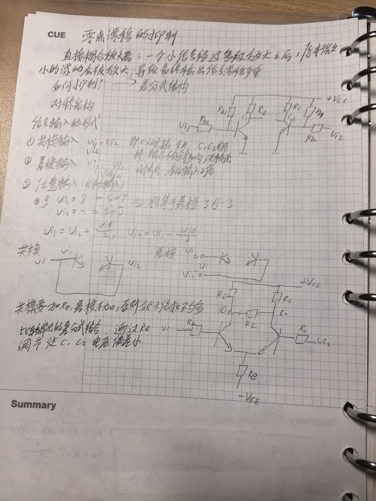
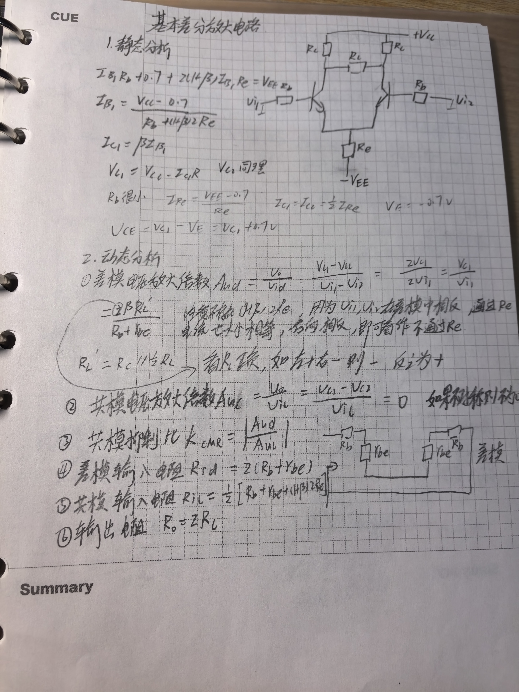
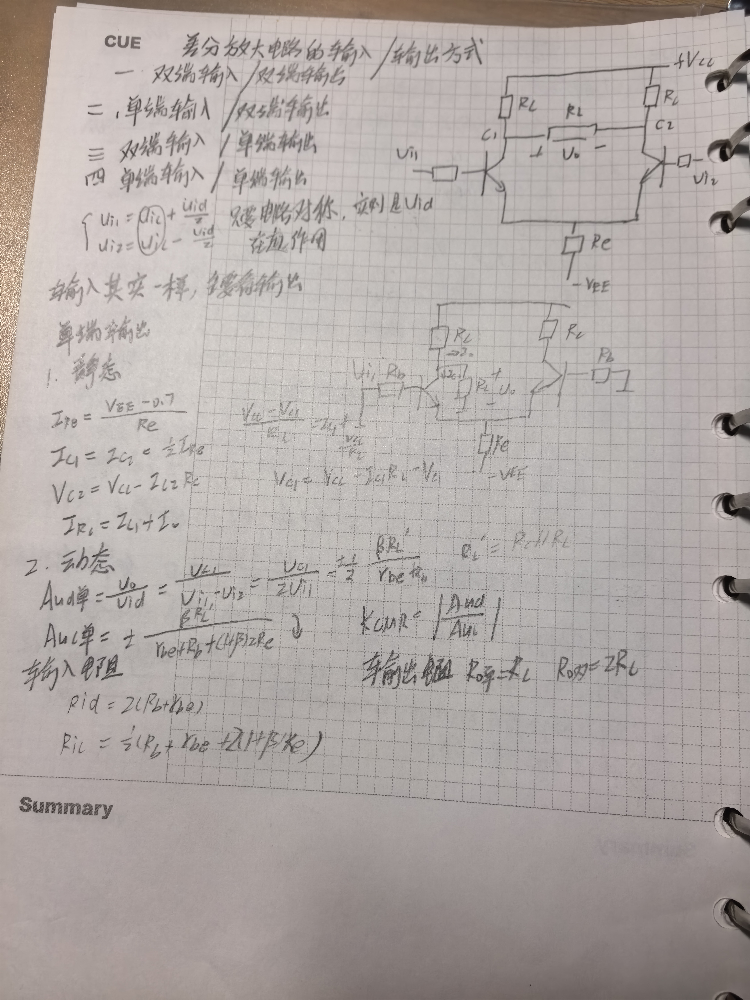
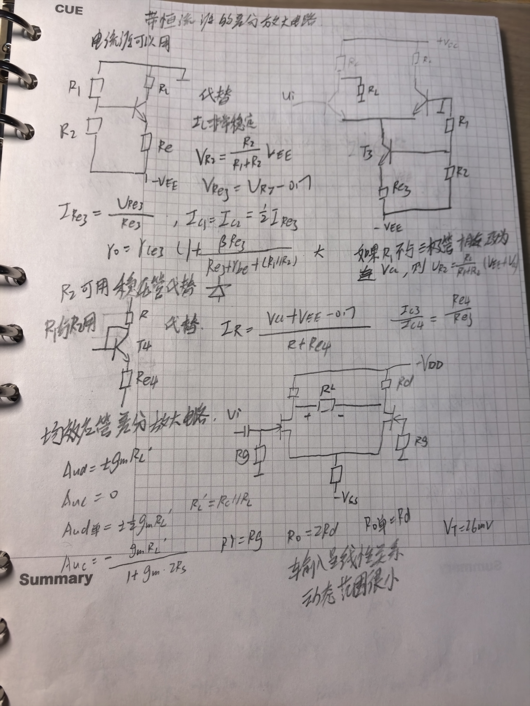
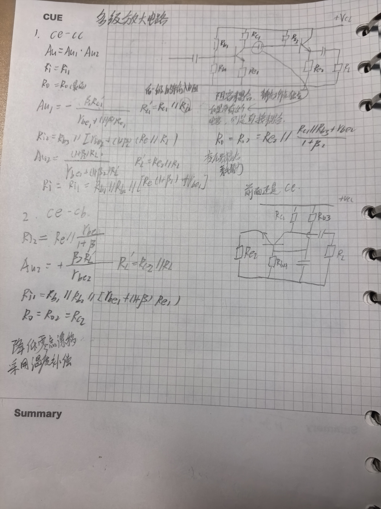
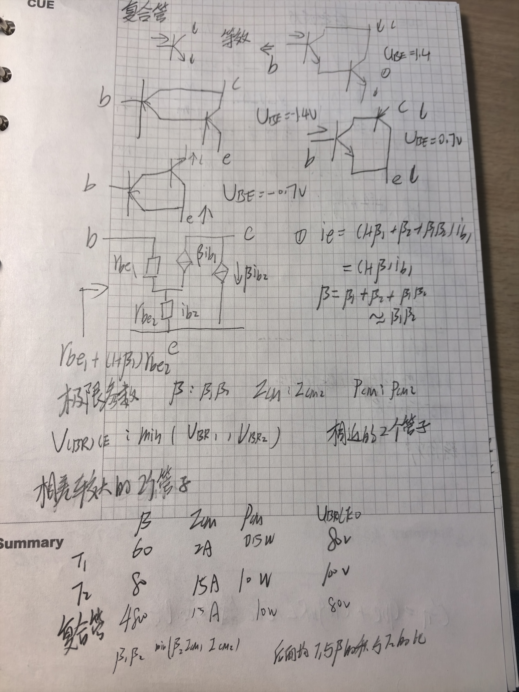

# 多级放大电路：差分放大、级联组合与复合管

> **导语**：手写笔记图文精讲：从零点漂移抑制到差分放大（基本分析、四种输入输出、恒流源），再到 CE-CC/CE-CB 级联与达林顿复合管，按「文字描述→图→图注→逐区注释」图文交错编排

* * *

## 第一部分　差分放大电路

### 一、零点漂移的抑制与差分放大电路概述

> **图注**：原笔记第 5 页。上方讲零点漂移问题与差分电路的对称结构、三种信号输入方式；中部用具体数值演示任意输入的分解；下方是共模、差模信号示意图与带恒流源偏置的差分电路。

#### 1.1 注释①：什么是零点漂移？为什么要差分？

图最上方写着：

> 「直接耦合放大器：一个信号经过多级放大之后，由于各级的零漂会被放大，导致最终输出有误。」

**解释**：直接耦合（级间直接相连，不用电容）可以放大直流和缓慢变化信号，但前级的微小直流漂移（主要由温度引起）会被后级逐级放大，输出端漂移严重，甚至淹没真实信号。图右侧写「如何克服？」——答案就是**差分式结构**。

#### 1.2 注释②：对称结构是核心

图写「对称结构」，并画了两个参数完全对称的共射管：左右两管特性一致，$R_{C1}=R_{C2}=R_C$，$R_{B1}=R_{B2}=R_B$。

**原理**：温度等外界因素对两管的影响相同，两管的漂移量相等、方向相同。由于输出取自两管集电极之差（双端输出），这些「同向漂移」相互抵消。这就是差分电路抑制零漂的根本。

#### 1.3 注释③：三种信号输入方式

图左侧列出「信号输入的三种方式」：

- **① 共模输入**：$u_{i1}=u_{i2}$，即两输入端加**大小相等、方向相同**的信号。图中注「即 $c_1$、$c_2$ 同相」——对共模信号，理想差分电路输出为零。
- **② 差模输入**：$u_{i1}=-u_{i2}$，两输入端加**大小相等、方向相反**的信号。图中注「两输入端信号大小相等、方向相反」，这是差分电路真正要放大的信号。
- **③ 任意输入（交模输入）**：既非纯共模也非纯差模的一般信号，可分解为共模分量与差模分量。

#### 1.4 注释④：任意输入的分解（数值演示）

图中给出一组具体数值演示分解方法：

$$ u_{i1}=8,\quad u_{i2}=2 $$

$$ u_{i1}= \frac{u_{i1}+u_{i2}}{2} + \frac{u_{i1}-u_{i2}}{2} $$

$$ u_{i2}= \frac{u_{i1}+u_{i2}}{2} - \frac{u_{i1}-u_{i2}}{2} $$

代入数值：共模分量 $=\dfrac{8+2}{2}=5$，差模分量 $=\dfrac{8-2}{2}=3$，故 $u_{i1}=5+3=8$，$u_{i2}=5-3=2$。

**一般公式**：

$$ u_{ic} = \frac{u_{i1}+u_{i2}}{2} \quad(\text{共模分量}) $$

$$ u_{id} = u_{i1}-u_{i2} \quad(\text{差模分量}) $$

于是 $u_{i1}=\dfrac{u_{ic}}{2}+\dfrac{u_{id}}{2}$，$u_{i2}=\dfrac{u_{ic}}{2}-\dfrac{u_{id}}{2}$。图中右侧写「相当于差模 3 个了」即差模分量幅值为 3。

#### 1.5 注释⑤：共模 / 差模信号示意图与公共电阻 $R_E$

图中部画了两个波形示意：

- **共模 $u_{ic}$**：$u_{i1}$、$u_{i2}$ 两条波形完全重叠、同相同幅。
- **差模 $u_{id}$**：$u_{i1}=\dfrac{u_{id}}{2}$、$u_{i2}=-\dfrac{u_{id}}{2}$，两条波形反相。

图下方写「共模要加 $R_E$，差模不加时，否则放大倍数不够」——意思是公共发射极电阻 $R_E$ 只对共模信号形成强负反馈（两管电流同向变化，在 $R_E$ 上叠加），对差模信号几乎不起作用（两管电流一增一减，在 $R_E$ 上抵消）。图中注「$R_E$ 越大越好，差模不存在差模 $R_E$ 的问题，只有共模有」。

再往下写「可以降低零漂，通过 $R_E$ 调节 $r_{c1}$、$r_{c2}$ 电位」——即增大 $R_E$ 能增强共模抑制。图中画了用恒流源替代 $R_E$ 的电路（$-V_{EE}$ 经恒流源接两管公共发射极）。

:::tip[差分电路的核心思想]
**放大差模、抑制共模**。温度漂移属于共模信号，被对称结构和大 $R_E$（或恒流源）压制；有用信号加在两输入端形成差模，被正常放大。
:::

* * *

### 二、基本差分放大电路：静态与动态分析

> **图注**：原笔记第 6 页。上半部分是基本差分放大电路图与静态分析公式，下半部分是动态分析的六个指标：差模增益、共模增益、共模抑制比、差模/共模输入电阻、输出电阻。

#### 2.1 注释⑥：静态分析

> **电路描述**：两管 NPN 对称，集电极各经 $R_C$ 接 $+V_{CC}$，基极各经 $R_b$ 接输入 $u_{i1}$、$u_{i2}$，两管发射极连在一起经公共电阻 $R_E$ 接 $-V_{EE}$。双端输出取自两集电极之间。

图左上方写出静态工作点计算：

$$ I_{B} = \frac{V_{EE}-0.7}{R_b + 2(1+\beta)R_E} $$

（图中写 $I_{B1}R_b+0.7+2I_{E1}R_E=V_{EE-2R_E}$ 形式的 KVL，整理得上式。）

$$ I_{B1} = \frac{V_{CC}-0.7}{R_b + 2(1+\beta)R_E} $$

$$ I_{C1} = \beta I_{B1} $$

$$ V_{C1} = V_{CC} - I_{C1}R_C \quad(\text{$V_{C2}$ 同理}) $$

当 $R_b$ 很小时，可直接求尾电流：

$$ I_{E0} = \frac{V_{EE}-0.7}{2R_E} $$

$$ I_{C1}=I_{C2}\approx \frac{1}{2}I_{E0} $$

$$ V_E = -0.7\,\mathrm{V} \quad (\text{两管基极电位约为 0，发射极电位约 } -0.7\mathrm{V}) $$

$$ U_{CE} = V_{C1}-V_E = V_{C1}+0.7\,\mathrm{V} $$

**解释**：静态时 $u_{i1}=u_{i2}=0$，两管电流相等，$R_E$ 中流过的是两管发射极电流之和 $2I_E$，所以 KVL 里出现 $2I_E R_E$。

#### 2.2 注释⑦：动态分析——差模电压放大倍数 $A_{ud}$

图左中部写出：

$$ A_{ud} = \frac{u_o}{u_{id}} = \frac{(u_{C1}-u_{C2})}{(u_{i1}-u_{i2})} = \frac{2u_{C1}}{2u_{i1}} = \frac{u_{C1}}{u_{i1}} = \frac{-\beta R_L'}{R_b + r_{be}} $$

其中

$$ R_L' = R_C \parallel \frac{1}{2}R_L $$

**差模等效电路的关键**：差模信号下两管电流一增一减、变化量大小相等方向相反，公共电阻 $R_E$ 中交流电流为零（相互抵消），相当于交流接地；负载 $R_L$ 接在两集电极之间，做差模等效时每边折合为 $\dfrac{1}{2}R_L$。图旁写「差模时 $R_E$ 相当于短路（交流），因为 $u_{i1}$、$u_{i2}$ 在差模中相反，电流 $i_{e1}$、$i_{e2}$ 大小相等、方向相反，即流向 $R_E$ 的电流为零，即Border $R_E$ 不通过 $R_E$」，正是这个意思。

图还写「看情况，如左有 $R_L$ 则 $\dfrac{1}{2}R_L$ 为 $+$」——指双端接负载时的折算。

#### 2.3 注释⑧：共模电压放大倍数 $A_{uc}$

$$ A_{uc} = \frac{u_o}{u_{ic}} = \frac{u_{C1}-u_{C2}}{u_{ic}} = 0 $$

**解释**：理想对称情况下，共模信号使两管集电极电位变化完全相同，$u_{C1}=u_{C2}$，双端输出相减为零。图注「如单端输出则不为 0」——单端输出时共模增益不为零，此时 $A_{uc}\approx-\dfrac{\beta R_C}{R_b+r_{be}+2(1+\beta)R_E}$，$R_E$ 越大共模增益越小。

#### 2.4 注释⑨：共模抑制比 $K_{CMR}$

$$ K_{CMR} = \left| \frac{A_{ud}}{A_{uc}} \right| $$

双端输出时 $A_{uc}=0$，$K_{CMR}\to\infty$（理想）；实际电路用分贝表示：$K_{CMR(\mathrm{dB})}=20\lg K_{CMR}$。它衡量电路放大差模、抑制共模的能力，越大越好。

#### 2.5 注释⑩：输入电阻与输出电阻

- **差模输入电阻**（图右下）

$$ R_{id} = 2(R_b + r_{be}) $$

从两输入端看进去，每边是 $R_b+r_{be}$，两边串联。

- **共模输入电阻**

$$ R_{ic} = \frac{1}{2}\big[\,R_b + r_{be} + 2(1+\beta)R_E\,\big] $$

共模时两输入端并联，且每边的 $R_E$ 被折算为 $2(1+\beta)R_E$。图中画了差模/共模输入电阻的等效电路对照（小方框标 $r_{be}$、$R_b$）。

- **输出电阻**（双端输出）

$$ R_o = 2R_C $$

双端从两集电极之间看进去，是两个 $R_C$ 串联。

:::important[基本差分电路小结]
双端输出时：**$A_{ud}=-\beta R_L'/(R_b+r_{be})$，$A_{uc}=0$，$K_{CMR}\to\infty$，$R_{id}=2(R_b+r_{be})$，$R_o=2R_C$**。
单端输出时 $A_{ud}$ 减半、$A_{uc}\ne0$，但省去一个输出端。
:::

* * *

### 三、差分放大电路的四种输入输出方式

> **图注**：原笔记第 7 页。上方列出四种接法（双端/单端输入 × 双端/单端输出），中部是双端输入双端输出电路与静态分析，下方是单端输出电路的动态指标。

#### 3.1 注释⑪：四种接法总览

图顶部列出：

1. **双端输入 / 双端输出**
2. **单端输入 / 双端输出**
3. **双端输入 / 单端输出**
4. **单端输入 / 单端输出**

图旁写：「只要电路对称，则 $u_{id}$ 存在有差模作用」「输入其实一样，注意有输出」——意思是**单端输入与双端输入的差模效果相同**（因为单端输入可分解为一对差模信号），区别主要在输出端。

且

$$ u_{i1}=\frac{u_{id}}{2}+\frac{u_{ic}}{2},\qquad u_{i2}=-\frac{u_{id}}{2}+\frac{u_{ic}}{2} $$

#### 3.2 注释⑫：双端输入双端输出的静态分析

图右上画的是双端输入双端输出电路（两管集电极间经 $R_L$ 连接）。静态分析：

$$ I_{B0} = \frac{V_{EE}-0.7}{R_E} $$

$$ I_{C1}=I_{C2}=\frac{1}{2}I_{B0} $$

$$ V_{C2}=V_{CC}-I_{C2}R_C $$

$$ I_{R_L} = I_{C1}+I_{C2} \quad (\text{流经 } R_L \text{ 的电流关系}) $$

$$ V_{C1} = V_{CC} - I_{C1}R_C - V_{R_L} $$

#### 3.3 注释⑬：单端输出的动态指标

图中部画单端输出电路（输出取自一侧集电极对地），写出：

$$ A_{u\text{单}} = \frac{u_{o1}}{u_{id}} = \frac{u_{C1}}{2u_{i1}} = \mp\frac{1}{2}\cdot\frac{\beta R_L'}{r_{be}+R_b} $$

其中

$$ R_L' = R_C \parallel R_L $$

（双端输出时 $R_L' = R_C\parallel \dfrac{1}{2}R_L$；单端输出时 $R_L'=R_C\parallel R_L$，注意区分。）

$$ A_{u\text{单}} = \mp\frac{\beta R_L'}{2(R_b+r_{be})} $$

图旁标 $K_{CMR}=\left|\dfrac{A_{ud}}{A_{uc}}\right|$。

输入电阻：

$$ R_{id}=2(R_b+r_{be}) $$

$$ R_{ic}=\frac{1}{2}\big[R_b+r_{be}+2(1+\beta)R_E\big] $$

输出电阻：

单端输出 $R_{o1}\approx R_C$；双端输出 $R_o=2R_C$。图中写「$R_{o双}=R_L$，$R_{o双}=2R_C$」（笔记笔迹，双端输出电阻为 $2R_C$）。

:::note[四种接法的增益规律]
- **双端输出**：$A_{ud}=-\beta R_L'/(R_b+r_{be})$（$R_L'=R_C\parallel R_L/2$），共模增益为 0。
- **单端输出**：$A_{ud}$ 约为双端的一半，共模增益不为 0，$K_{CMR}$ 有限。
- 输入方式（单端/双端）不改变差模增益，只改变共模分量大小。
:::

* * *

### 四、带恒流源的差分放大电路与场效应管差分

> **图注**：原笔记第 8 页。上半部分是带恒流源（含温度补偿）的差分放大电路与恒流源设计；下半部分是场效应管差分放大电路的公式与特点。

#### 4.1 注释⑭：为什么要用恒流源替代 $R_E$

图左上写「带恒流源 $R_{e3}$ 的差分放大电路，电流源可以用」。前面讲过 $R_E$ 越大共模抑制越好，但 $R_E$ 太大会导致所需负电源 $-V_{EE}$ 过高、静态电流失衡。用**恒流源**替代 $R_E$ 可以在不大的电源电压下获得等效极大的交流电阻，是理想方案。

#### 4.2 注释⑮：恒流源电路的设计

图左上画出用 $R_1$、$R_2$ 分压加 $R_{e3}$ 的恒流源：

$$ V_{B3} = \frac{R_2}{R_1+R_2}\,V_{EE} $$

$$ V_{BE3} = V_{B3} - 0.7 $$

$$ I_{E3} = \frac{V_{BE3}}{R_{e3}} $$

$$ I_{C1}=I_{C2}=\frac{1}{2}I_{E3} $$

图注「$R_2$ 可用稳压管代替」，右侧标注「$r_o= r_{ce3}\left(1+\dfrac{\beta R_{e3}}{R_{e3}+R_b+(1+\beta/2?)}\right)$ 大」——恒流源管的输出电阻 $r_o$ 很大，这正是等效 $R_E$ 很大的原因。

图右上写「如果 $R_1$ 不行可用稳压管或 $V_{EE}$，则 $V_{B3}=\dfrac{R_2}{R_1+R_2}(V_{CC}+V_{EE})$」，即拓宽了基准电压的取值范围。

#### 4.3 注释⑯：温度补偿

图中部写「$R_4$ 可用 $R_4$ 代替 $V_{BE}$」并画了 $T_4$ 管：

$$ I_R = \frac{V_{CC}+V_{EE}-0.7}{R+R_{e4}} $$

$$ \frac{I_{C3}}{I_{C4}} = \frac{R_{e4}}{R_{e3}} $$

利用 $T_4$ 的 $V_{BE}$ 随温度变化的特性抵消 $T_3$ 的漂移，稳定恒流源电流。

#### 4.4 注释⑰：场效应管差分放大电路

图下半部画了 FET 差分（两管源极相连经恒流源到 $-V_{GS}$，漏极各经 $R_D$ 接 $+V_{DD}$，双端输出经 $R_L$）。公式：

$$ A_{ud} = \pm g_m R_L' \quad (\text{单端 } \pm\tfrac{1}{2}g_m R_L') $$

$$ A_{uc}=0 $$

$$ A_{ud\text{单}} = \pm\frac{1}{2}g_m R_L' $$

$$ A_{uc\text{单}} = -\frac{g_m R_L'}{1+2g_m R_S} $$

其中 $R_L'=R_D\parallel\dfrac{1}{2}R_L$。

输入/输出电阻：

$$ R_i = R_G $$

$$ R_o = 2R_D \quad(\text{双端}),\qquad R_{o\text{单}} = R_D $$

图右下写「非线性关系，动态范围很小」——FET 差分虽输入电阻极高，但跨导 $g_m$ 的非线性使线性动态范围比双极型小。

:::important[恒流源差分 vs 电阻差分]
用恒流源替代尾电阻 $R_E$ 后，等效交流电阻极大 → 共模增益 $A_{uc}$ 更小 → $K_{CMR}$ 更高，静态工作点也更稳定。这是集成运放输入级的标准做法。
:::

* * *

### 五、本篇小结与易错点

#### 5.1 核心公式速查（双端输入双端输出，基本差分）

| 指标 | 公式 |
| :--- | :--- |
| 差模增益 $A_{ud}$ | $-\dfrac{\beta (R_C\parallel R_L/2)}{R_b+r_{be}}$ |
| 共模增益 $A_{uc}$ | $0$（理想对称）；单端 $\approx-\dfrac{\beta R_C}{R_b+r_{be}+2(1+\beta)R_E}$ |
| 共模抑制比 $K_{CMR}$ | $\left|A_{ud}/A_{uc}\right|$，双端理想为 $\infty$ |
| 差模输入电阻 $R_{id}$ | $2(R_b+r_{be})$ |
| 共模输入电阻 $R_{ic}$ | $\dfrac{1}{2}[R_b+r_{be}+2(1+\beta)R_E]$ |
| 输出电阻 $R_o$ | $2R_C$（双端）/ $R_C$（单端） |

#### 5.2 易错点提醒

- **差模时 $R_E$ 交流接地，共模时 $R_E$ 等效为 $2(1+\beta)R_E$**——这是分析的关键分水岭。
- **单端 vs 双端输出**：单端增益减半、共模增益不为零、$R_o$ 从 $2R_C$ 变 $R_C$。
- **$R_L$ 折算**：双端输出 $R_C\parallel R_L/2$，单端输出 $R_C\parallel R_L$。
- **恒流源的作用**：提高等效尾电阻、抑制共模、稳定 Q 点，不是提高差模增益。

#### 5.3 解题要点

1. 先把输入分解为 $u_{ic}$、$u_{id}$。
2. 画差模半电路（$R_E$ 接地）与共模半电路（$R_E$ 变 $2R_E$）分别分析。
3. 判断双端还是单端输出，选对增益、$R_L'$、$R_o$ 公式。
4. 涉及恒流源时先求 $I_{E3}$，再平分得 $I_{C1}=I_{C2}$。

* * *

## 第二部分　多级放大电路与复合管

### 一、多级放大电路：CE-CC 与 CE-CB 组合

> **图注**：原笔记第 9 页。上半部分是 CE-CC（共射-共集）两级电路的电路图与全套公式，下半部分是 CE-CB（共射-共基）组合的公式与电路，末尾两条手写提醒涉及零点漂移与温度补偿。

#### 1.1 注释①：多级放大电路的总指标

图左上第一组公式给出了多级放大的通式：

$$ A_u = A_{u1}\cdot A_{u2} $$

$$ R_i = R_{i1} $$

$$ R_o = R_{o(\text{末级})} $$

**解释**：总电压增益等于各级增益之积（注意是电压比相乘，若用分贝则为相加）；多级放大器的输入电阻就是**第一级**的输入电阻；输出电阻就是**最后一级**的输出电阻。图中写 $R_o=R_{o(最后一级)}$ 正是此意。

> **重要**：级数越多增益越大，但通频带越窄、噪声与漂移也越累积。不能盲目堆级数。

#### 1.2 注释②：CE-CC 组合（第一级共射 + 第二级共集）

图中第一级是共射电路、第二级是共集电路（射极输出器），这是最经典的「增益 + 带载」搭配。

- **第一级（CE）电压增益**

$$ A_{u1} = -\frac{\beta_1 R_{L1}'}{r_{be1}+(1+\beta_1)R_{e1}} $$

其中第一级的交流负载 $R_{L1}'$ 就是第二级的输入电阻：$R_{L1}'=R_{i2}$。图旁标注「阻容耦合，前后级 $Z_{in}$ 不影响…直接耦合」——意思是阻容耦合时前后级直流互不影响、但交流负载要计入后级输入电阻；直接耦合则交直流都互相影响。

- **第二级输入电阻**

$$ R_{i2} = R_{B1}\parallel R_{B2}\parallel\big[\,r_{be2}+(1+\beta_2)(R_{e2}\parallel R_L)\,\big] $$

（图中写 $R_{i2}=R_{B1}\parallel R_{B2}\parallel[r_{be1}+(1+\beta_2)(R_{e2}\parallel R_L)]$ 形式。）

- **第二级（CC）电压增益**

$$ A_{u2} = \frac{(1+\beta_2)R_{L2}'}{r_{be2}+(1+\beta_2)R_{L2}'} $$

其中 $R_{L2}'=R_{e2}\parallel R_L$。因是射极输出器，$A_{u2}<1$ 但接近 1，同相。

- **总输入/输出电阻**

$$ R_i = R_{i1} = R_{B1}\parallel R_{B2}\parallel\big[\,r_{be1}+(1+\beta_1)R_{e1}\,\big] $$

$$ R_o = R_{o2} = R_{e2}\parallel\frac{(R_{B2}\parallel R_{s}')+r_{be2}}{1+\beta_2} $$

**CE-CC 的意义**：共射级提供电压增益，共集级提供低输出电阻、增强带载能力。整体「增益可观、输出电阻小」。

:::tip[多级分析三步]
① 把后级输入电阻当作前级负载；② 逐级算增益再相乘；③ $R_i$ 看首级、$R_o$ 看末级。
:::

#### 1.3 注释③：CE-CB 组合（共射-共基）

图下半部分是 CE-CB 组合，先写第二级（CB）输入电阻：

$$ R_{i2} = R_{e2}\parallel\frac{r_{be2}}{1+\beta_2} $$

共基电路从发射极看进去的输入电阻很小，约 $r_{be}/(1+\beta)$。

- **第二级（CB）电压增益**

$$ A_{u2} = +\frac{\beta_2 R_{L2}'}{r_{be2}} $$

其中 $R_{L2}'=R_{C2}\parallel R_L$。注意共基电路**不反相**（正号），这是它与共射的关键区别。

- **第一级输入电阻**（第一级仍为带 $R_{e1}$ 的共射）

$$ R_{i1} = R_{B1}\parallel R_{B2}\parallel\big[\,r_{be1}+(1+\beta_1)R_{e1}\,\big] $$

**CE-CB 的意义**：共基级频率特性好、输出电阻高，与共射级联可改善高频响应（这是「共射-共基」组合常用于宽频带放大器的原因）。

#### 1.4 注释④：零点漂移与温度补偿

图末尾两行手写：「降低零点漂移采用温度补偿」。呼应前面差分放大电路的内容——多级直接耦合放大器必须抑制零漂，常用温度补偿（热敏元件、差分结构、恒流源）来稳定静态工作点。

* * *

### 二、复合管（达林顿管）

> **图注**：原笔记第 10 页。上半部分是两种极性的复合管等效结构（NPN+NPN、NPN+PNP）及 $U_{BE}$ 标注，中部是复合管的电流放大系数 $\beta$ 与小信号模型推导，下半部分是极限参数说明与一张 T1、T2、复合管参数对照表。

#### 2.1 注释⑤：什么是复合管

图左上画了两只三极管「搭」在一起的结构，并标注箭头等效成一只大三极管。复合管（达林顿管 Darlington）把前管的发射极接后管的基极，两管集电极相连，对外等效为一只三极管：

- **NPN + NPN → 等效 NPN**，$U_{BE}=U_{BE1}+U_{BE2}\approx 0.7+0.7=1.4\,\mathrm{V}$（图中标 $U_{BE}=1.4\mathrm{V}$）。
- **NPN + PNP → 等效 NPN**，图中标 $U_{BE}=+0.7\mathrm{V}$（不同接法的压降不同）。
- 图中还标了 $U_{BE}=-0.7\mathrm{V}$、$U_{CE}=0.7\mathrm{V}$ 等不同组合，说明**等效管的类型由第一只管决定**。

#### 2.2 注释⑥：等效电流放大系数 $\beta$

图中部写出电流关系与 β 的推导：

$$ i_B = (1+\beta_1)i_{b2} $$

$$ i_C = \beta_1 i_{b1} + \beta_2 i_{b2} = \beta_1 i_{b1}+\beta_2(1+\beta_1)i_{b1} $$

$$ = (1+\beta_1)(1+\beta_2)i_{b1}-i_{b1} \;\Rightarrow\; \beta = \beta_1+\beta_2+\beta_1\beta_2 \approx \beta_1\beta_2 $$

**解释**：因为后管的基极电流就是前管的发射极电流 $(1+\beta_1)i_{b1}$，两管电流逐级放大，总 β 约等于两管 β 的乘积。图中写「$\beta=\beta_1+\beta_2+\beta_1\beta_2\approx\beta_1\beta_2$」——所以复合管能获得极高的电流放大系数。

图中还画了复合管的小信号模型：基极回路里 $r_{be1}+(1+\beta_1)r_{be2}$，受控源 $\beta_1 i_{b1}$ 与 $\beta_2 i_{b2}$ 串联，输入电阻很大。

#### 2.3 注释⑦：极限参数

图中部写「极限参数」四条：

- **$\beta$**：$\beta=\beta_1\beta_2$（近似）。
- **$I_{CM}$**：$I_{CM}=\min(I_{CM1},I_{CM2})$——复合管的最大集电极电流受限于较弱的那一管。图中写「$I_{CM}=\min(I_{B1},I_{CM2})$」（笔迹，实为两管中较小的 $I_{CM}$）。
- **$P_{CM}$**：$P_{CM}=P_{CM1}+P_{CM2}$（两管功耗之和，但受散热限制）。
- **$U_{(BR)CEO}$**：$U_{(BR)CEO}=\min(U_{(BR)1},U_{(BR)2})$——击穿电压取两管中较小的。图注「相近的 2 个管子」指两管参数应匹配。

#### 2.4 注释⑧：参数对照表（数值算例）

图底部表格给出一组具体数值：

| 管子 | $\beta$ | $I_{CM}$ | $P_{CM}$ | $U_{(BR)CEO}$ |
| :--- | :---: | :---: | :---: | :---: |
| $T_1$ | 60 | 2 A | 0.5 W | 80 V |
| $T_2$ | 80 | 15 A | 10 W | 100 V |
| **复合管** | 4800 | 15 A | 10 W | 80 V |

验证：

$$ \beta \approx \beta_1\beta_2 = 60\times 80 = 4800 $$

$$ I_{CM} = \min(2,15) \;\text{受前管限制，实际约 } 2\,\mathrm{A}\ \text{量级（表中记 15 A 为后管额定）} $$

$$ P_{CM} \approx 0.5+10 = 10.5\,\mathrm{W}\ (\text{表中取 }10\,\mathrm{W}) $$

$$ U_{(BR)CEO} = \min(80,100) = 80\,\mathrm{V} $$

图末写「$\beta\approx\beta_1\beta_2$，$I_{CM}=\min(I_{C1},I_{C2})$，反向…$U_{(BR)CEO}=\min$」，强调复合管的高 β、受限的耐压与电流。

:::important[复合管要点]
**$\beta\approx\beta_1\beta_2$ 极高、输入电阻大、$U_{BE}\approx1.4\mathrm{V}$（比单管大一倍）**；但 $U_{(BR)CEO}$、$I_{CM}$ 取两管中较小者，饱和压降和开关速度也受影响。常用于大功率驱动与达林顿输出级。
:::

* * *

### 三、本篇小结与易错点

#### 3.1 核心公式速查

| 组合 | 关键公式 |
| :--- | :--- |
| 多级通用 | $A_u=A_{u1}A_{u2}$，$R_i=R_{i1}$，$R_o=R_{o(\text{末级})}$ |
| CE 级 | $A_{u1}=-\beta_1 R_{L1}'/[r_{be1}+(1+\beta_1)R_{e1}]$，$R_{L1}'=R_{i2}$ |
| CC 级 | $A_{u2}=(1+\beta_2)R_{L2}'/[r_{be2}+(1+\beta_2)R_{L2}']$ |
| CB 级 | $A_{u2}=+\beta_2 R_{L2}'/r_{be2}$（不反相），$R_{i2}=R_{e2}\parallel r_{be2}/(1+\beta_2)$ |
| 复合管 | $\beta\approx\beta_1\beta_2$，$U_{BE}\approx1.4\mathrm{V}$，$U_{(BR)CEO}=\min(\cdot)$ |

#### 3.2 易错点提醒

- **级间负载效应**：算前级增益时必须把后级输入电阻并进去当负载，不能孤立计算。
- **共基不反相**：CB 级 $A_u$ 为正号，共射、共源为负号。
- **复合管的类型由第一管定**，$U_{BE}$ 是两管之和（约 1.4V），不是 0.7V。
- **复合管的 $U_{(BR)CEO}$、$I_{CM}$ 取较小者**，别取较大值。

#### 3.3 解题要点

1. 画框图：把每级看作一个「增益块 + 输入电阻 + 输出电阻」。
2. 从后往前算：先定末级 $R_i$，作为前级负载。
3. 复合管先判等效类型，再套 $\beta\approx\beta_1\beta_2$ 与极限参数取小的规则。
